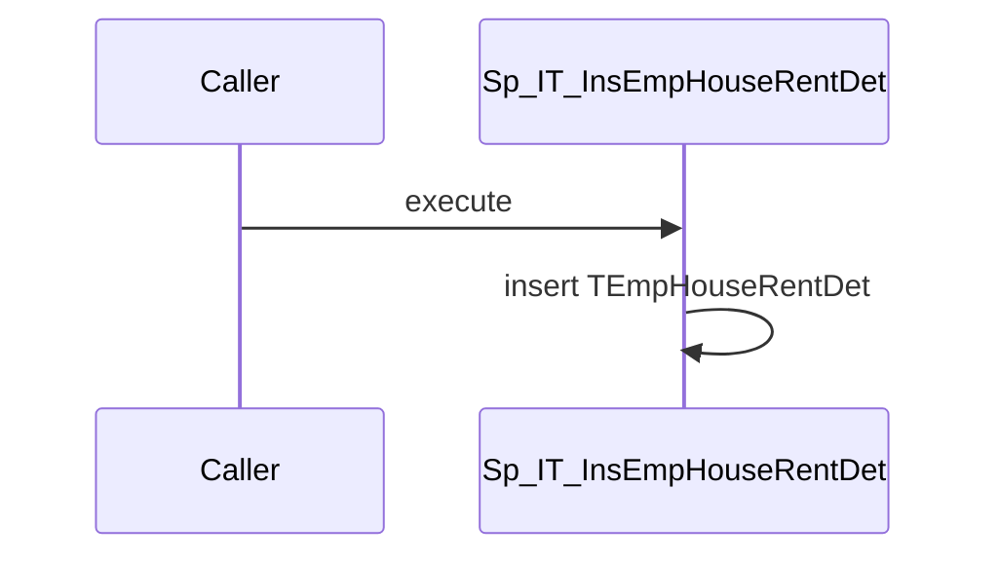
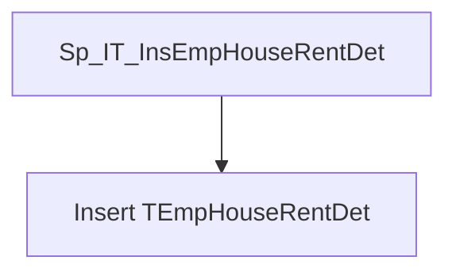

# Sp_IT_InsEmpHouseRentDet

## What it does

Inserts one HRA / house-rent declaration row for an employee assessment.

## Parameters

| Name | Direction | What it is for |
|---|---|---|
| `@EmployerId` | in | Employer |
| `@AssessmentId` | in | Assessment year id |
| `@Employeeid` | in | Employee |
| `@RentFrom` | in | Rent period start |
| `@RentTo` | in | Rent period end |
| `@ActualAmount` | in | Actual rent amount |
| `@EstimatedAmount` | in | Estimated rent amount |
| `@Address` | in | Address text |
| `@CityType` | in | Metro / non-metro value |
| `@LandLordPan` | in | Landlord PAN |
| `@IsEnabled` | in | Y/N enabled flag |
| `@CreatedBy` | in | Creating employee id |

## Call sequence

Calls no other procedures or functions.

## Callers

No other procedure or function calls this object. Application caller: Core Node `IncomeTaxDeclarationDAL` insert helpers used by `InsertITDeclaration` / update-when-id-0 paths.

## Nested

Calls no other procedures or functions.

## Steps

1. Script is `HRMS-DATABASE/HRMS/STOREPROCEDURE/Sp_IT_InsEmpHouseRentDet.sql`.
2. Insert one row into `TEmpHouseRentDet` with `CreatedDate = getdate()`.

## Tables

| Table | Read or write |
|---|---|
| `dbo.TEmpHouseRentDet` | write |

## Flow

