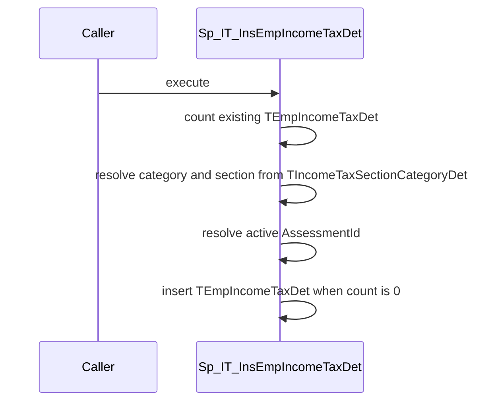
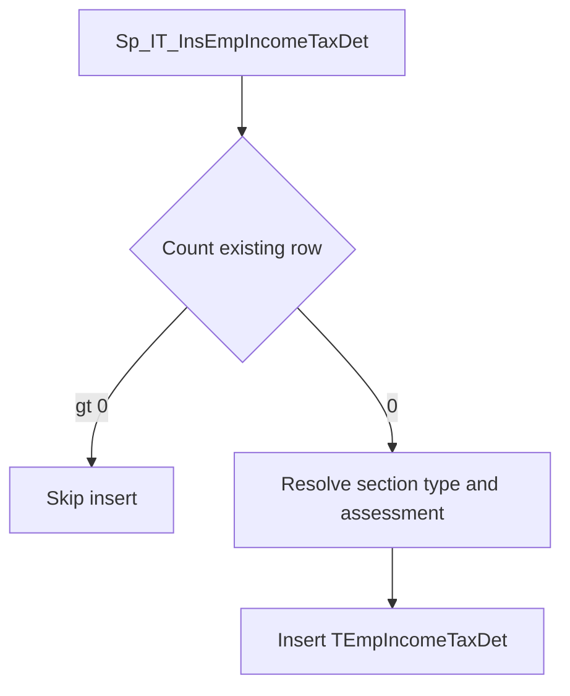

# Sp_IT_InsEmpIncomeTaxDet

## What it does

Inserts one employee section-category amount row into `TEmpIncomeTaxDet` for the active assessment year, resolving section and category-type ids from `TIncomeTaxSectionCategoryDet`. Skips insert when `@Lv_cnt` is already non-zero (see Steps).

## Parameters

| Name | Direction | What it is for |
|---|---|---|
| `@Employeeid` | in | Employee |
| `@IncomeTaxSecDetId` | in | Section category detail id |
| `@ActualAmount` | in | Actual amount |
| `@EstimatedAmount` | in | Estimated amount |
| `@CreatedBy` | in | Creating employee id |
| `@ActualSubmitted` | in | Optional; defaults to `N` |

## Call sequence

Calls no other procedures or functions.

## Callers

No other procedure or function calls this object. Application caller: `IncomeTaxDeclarationDAL.InsertITSectionDetails`.

## Nested

Calls no other procedures or functions.

## Steps

1. Script is `HRMS-DATABASE/HRMS/STOREPROCEDURE/Sp_IT_InsEmpIncomeTaxDet.sql`.
2. Count existing `TEmpIncomeTaxDet` using `@Employeeid` plus `@IncomeTaxSecId` / `@IncomeTaxCategoryTypeId` / `@IncomeTaxSecDetId`. Those section/type variables are still null at this point in the script.
3. When count is 0, read `CategoryType` and `IncomeTaxsecid` from `TIncomeTaxSectionCategoryDet` for `@IncomeTaxSecDetId`.
4. Read active `Assessmentid` from `tassessmentYear`.
5. Insert `TEmpIncomeTaxDet` with estimated/actual amounts and `@ActualSubmitted`.

## Tables

| Table | Read or write |
|---|---|
| `dbo.TEmpIncomeTaxDet` | read/write |
| `dbo.TIncomeTaxSectionCategoryDet` | read |
| `dbo.tassessmentYear` | read |

## Flow

