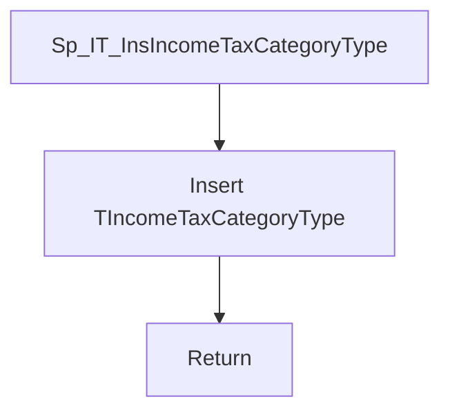

# Sp_IT_InsIncomeTaxCategoryType

## What it does

Inserts one category-type row under an income-tax section into `TIncomeTaxCategoryType`, scoped by employer. Used by PayRoll Setup Masters Manage Category Types Submit.

## Parameters

| Name | Direction | What it is for |
|---|---|---|
| `@SectionId` | in | Parent `TIncomeTaxSection.IncomeTaxSecId` |
| `@CategoryTypeName` | in | Display name of the type |
| `@IsAtive` | in | Active flag (`Y`/`N`); parameter spelling matches DAL |
| `@CreatedBy` | in | Employee id of the creator |
| `@Employerid` | in | Employer that owns the type |

## Call sequence

Calls no other procedures or functions.

## Callers

| Object | Kind | Page |
|---|---|---|
| `IncomeTaxDeclarationDAL.InsertCategoryTypes` | app | [Setup Masters](/docs/guides/payroll/setup-masters) via `POST /IncomeTax/InsertCategoryTypes` |

No other procedure in `STOREPROCEDURE/` executes it.

## Nested

Calls no other procedures or functions.

## Steps

1. Script is `HRMS-DATABASE/HRMS/STOREPROCEDURE/Sp_IT_InsIncomeTaxCategoryType.sql`.
2. `INSERT` into `TIncomeTaxCategoryType` with `CreatedDate = GETDATE()`.

## Tables

| Table | Read or write |
|---|---|
| `dbo.TIncomeTaxCategoryType` | write |

## Unresolved calls

None.

## Flow

