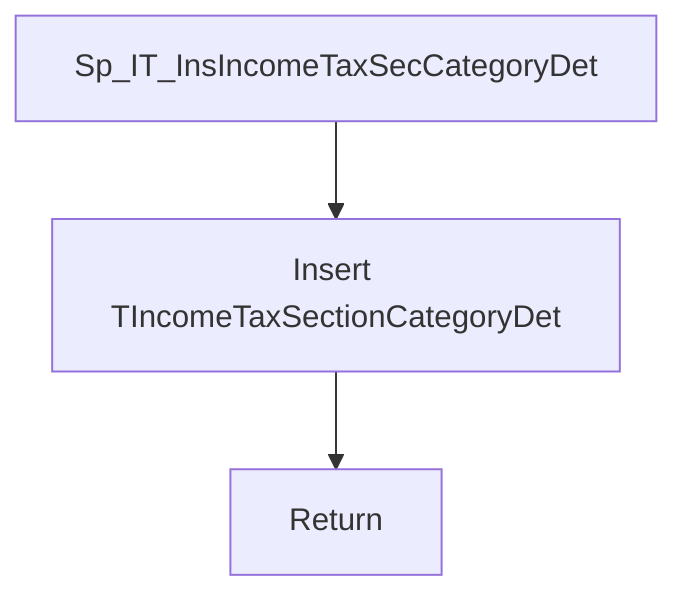

# Sp_IT_InsIncomeTaxSecCategoryDet

## What it does

Inserts one category detail row under an income-tax section into `TIncomeTaxSectionCategoryDet`, including category type, limit, amount, and active flag. Used by PayRoll Setup Masters Manage Categories Submit.

## Parameters

| Name | Direction | What it is for |
|---|---|---|
| `@SectionId` | in | Parent section id |
| `@CateoryName` | in | Category name; parameter spelling matches DAL |
| `@CategoryType` | in | `TIncomeTaxCategoryType.IncomeTaxCategoryTypeId` |
| `@Limit` | in | Limit flag (`Y`/`N`) |
| `@Amount` | in | Category amount |
| `@IsAtive` | in | Active flag (`Y`/`N`); parameter spelling matches DAL |
| `@CreatedBy` | in | Employee id of the creator |

## Call sequence

Calls no other procedures or functions.

## Callers

| Object | Kind | Page |
|---|---|---|
| `IncomeTaxDeclarationDAL.InsertCategories` | app | [Setup Masters](/docs/guides/payroll/setup-masters) via `POST /IncomeTax/InsertCategories` |

No other procedure in `STOREPROCEDURE/` executes it.

## Nested

Calls no other procedures or functions.

## Steps

1. Script is `HRMS-DATABASE/HRMS/STOREPROCEDURE/Sp_IT_InsIncomeTaxSecCategoryDet.sql`.
2. `INSERT` into `TIncomeTaxSectionCategoryDet` with `CreatedDate = GETDATE()`.

## Tables

| Table | Read or write |
|---|---|
| `dbo.TIncomeTaxSectionCategoryDet` | write |

## Unresolved calls

None.

## Flow

