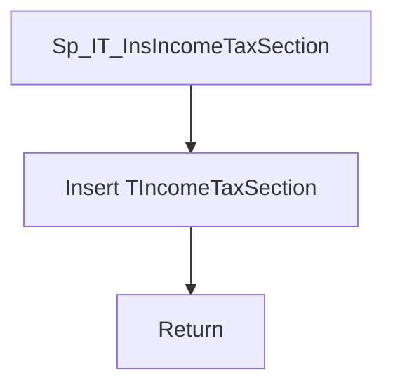

# Sp_IT_InsIncomeTaxSection

## What it does

Inserts one income-tax section master row for an employer into `TIncomeTaxSection`, including optional limit flag, amount, and active flag. Used by PayRoll Setup Masters when an administrator submits Manage Sections.

## Parameters

| Name | Direction | What it is for |
|---|---|---|
| `@EmployerId` | in | Employer that owns the section |
| `@SectionName` | in | Display name of the section |
| `@Limit` | in | Limit flag (`Y`/`N`) |
| `@Amount` | in | Section amount |
| `@IsAtive` | in | Active flag (`Y`/`N`); parameter spelling matches DAL |
| `@CreatedBy` | in | Employee id of the creator |

## Call sequence

Calls no other procedures or functions.

## Callers

| Object | Kind | Page |
|---|---|---|
| `IncomeTaxDeclarationDAL.InsertSections` | app | [Setup Masters](/docs/guides/payroll/setup-masters) via `POST /IncomeTax/IncomeTaxSection` |

No other procedure in `STOREPROCEDURE/` executes it.

## Nested

Calls no other procedures or functions.

## Steps

1. Script is `HRMS-DATABASE/HRMS/STOREPROCEDURE/Sp_IT_InsIncomeTaxSection.sql`.
2. `INSERT` into `TIncomeTaxSection` with `CreatedDate = GETDATE()`.

## Tables

| Table | Read or write |
|---|---|
| `dbo.TIncomeTaxSection` | write |

## Unresolved calls

None.

## Flow

