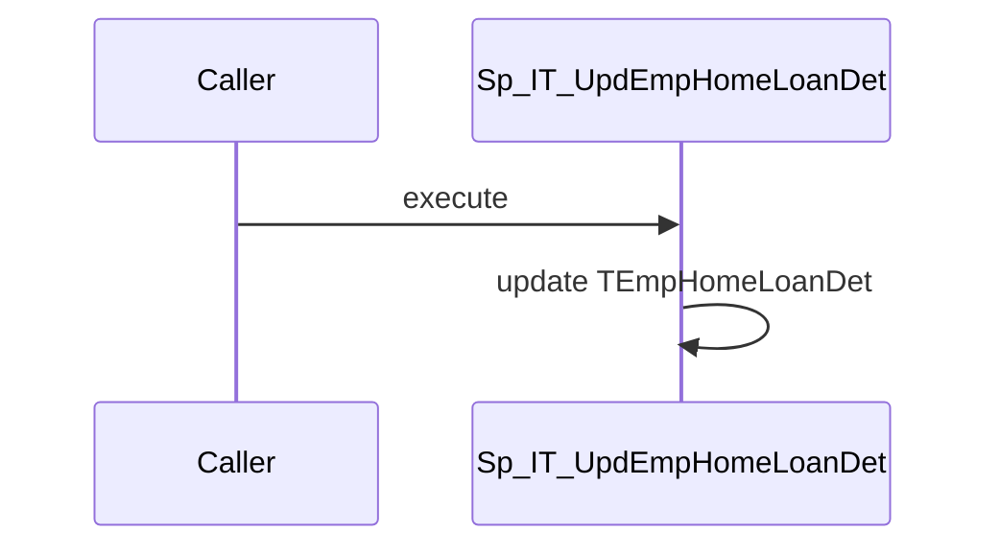
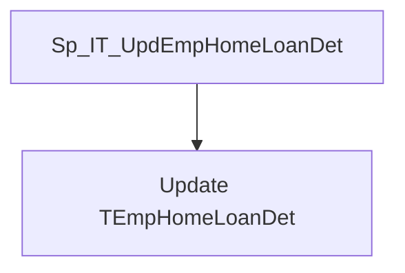

# Sp_IT_UpdEmpHomeLoanDet

## What it does

Updates an existing self-occupied home-loan declaration row.

## Parameters

| Name | Direction | What it is for |
|---|---|---|
| `@HomeLoanId` | in | Row key |
| `@EstPrincipalAmount` | in | Estimated principal |
| `@EstInterestAmount` | in | Estimated interest |
| `@ActPrincipalAmount` | in | Actual principal |
| `@ActInterestAmount` | in | Actual interest |
| `@LenderName` | in | Lender name |
| `@LandLordPan` | in | Lender PAN |
| `@IsEnabled` | in | Y/N enabled flag |
| `@ModifiedBy` | in | Modifying employee id |

## Call sequence

Calls no other procedures or functions.

## Callers

No other procedure or function calls this object. Application caller: Core Node `IncomeTaxDeclarationDAL` update helpers used by `UpdateITDeclaration`.

## Nested

Calls no other procedures or functions.

## Steps

1. Script is `HRMS-DATABASE/HRMS/STOREPROCEDURE/Sp_IT_UpdEmpHomeLoanDet.sql`.
2. Update `TEmpHomeLoanDet` where `HomeLoanId` equals `@HomeLoanId`.
3. Sets `ModifiedDate = Getdate()` (and the modified-by / amount columns from parameters).

## Tables

| Table | Read or write |
|---|---|
| `dbo.TEmpHomeLoanDet` | write |

## Flow

