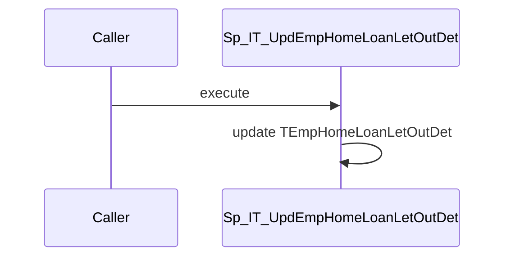
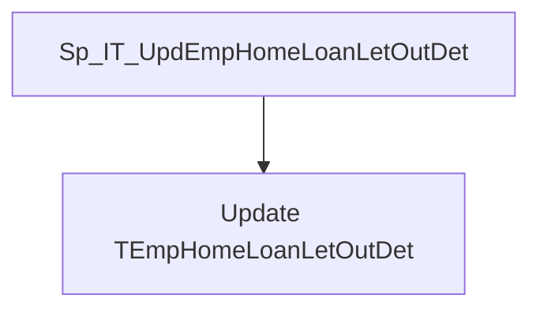

# Sp_IT_UpdEmpHomeLoanLetOutDet

## What it does

Intended to update one let-out declaration row. The script WHERE clause compares `HomeLoanDetId` to itself, so every row can be updated.

## Parameters

| Name | Direction | What it is for |
|---|---|---|
| `@HomeLoanDetId` | in | Intended row key |
| `@EstAnnualRentRec` | in | Estimated annual rent received |
| `@EstMunicipalTaxPaid` | in | Estimated municipal tax |
| `@EstNetAnnualVal` | in | Estimated net annual value |
| `@ActAnnualRentRec` | in | Actual annual rent received |
| `@ActMunicipalTaxPaid` | in | Actual municipal tax |
| `@ActNetAnnualVal` | in | Actual net annual value |
| `@EstStandardDeduction` | in | Estimated standard deduction |
| `@EstPrincipalPaid` | in | Estimated principal paid |
| `@EstInterestPaid` | in | Estimated interest paid |
| `@EstNetIncome` | in | Estimated net income |
| `@RepayHomeLoan` | in | Y/N repaying home loan |
| `@ActStandardDeduction` | in | Actual standard deduction |
| `@ActPrincipalPaid` | in | Actual principal paid |
| `@ActInterestPaid` | in | Actual interest paid |
| `@ActNetIncome` | in | Actual net income |
| `@LenderName` | in | Lender name |
| `@LenderPan` | in | Lender PAN |
| `@IsEnabled` | in | Y/N enabled flag |
| `@ModifiedBy` | in | Modifying employee id |

## Call sequence

Calls no other procedures or functions.

## Callers

No other procedure or function calls this object. Application caller: Core Node `IncomeTaxDeclarationDAL` update helpers used by `UpdateITDeclaration`.

## Nested

Calls no other procedures or functions.

## Steps

1. Script is `HRMS-DATABASE/HRMS/STOREPROCEDURE/Sp_IT_UpdEmpHomeLoanLetOutDet.sql`.
2. Sets let-out columns then filters with `where HomeLoanDetId=HomeLoanDetId` (always true in the current script).
3. Sets `ModifiedDate = Getdate()` (and the modified-by / amount columns from parameters).

## Tables

| Table | Read or write |
|---|---|
| `dbo.TEmpHomeLoanLetOutDet` | write |

## Flow

