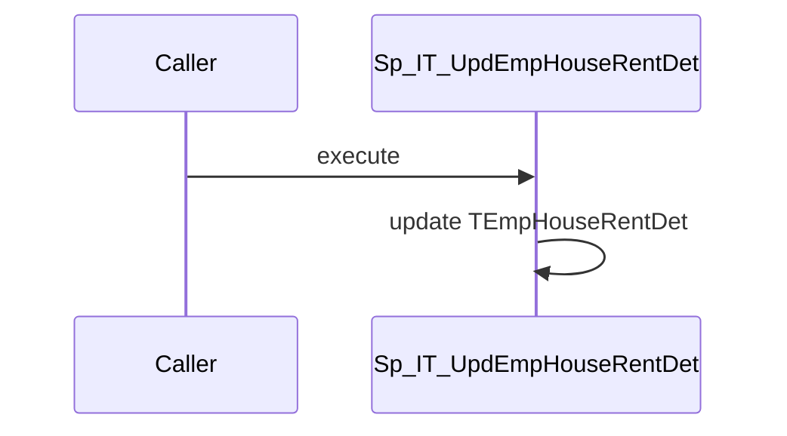
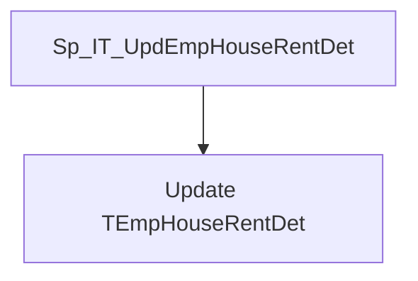

# Sp_IT_UpdEmpHouseRentDet

## What it does

Updates an existing HRA / house-rent declaration row.

## Parameters

| Name | Direction | What it is for |
|---|---|---|
| `@HouseRentId` | in | Row key |
| `@RentFrom` | in | Rent period start |
| `@RentTo` | in | Rent period end |
| `@ActualAmount` | in | Actual rent amount |
| `@EstimatedAmount` | in | Estimated rent amount |
| `@Address` | in | Address text |
| `@CityType` | in | City type |
| `@LandLordPan` | in | Landlord PAN |
| `@IsEnabled` | in | Y/N enabled flag |
| `@ModifiedBy` | in | Modifying employee id |

## Call sequence

Calls no other procedures or functions.

## Callers

No other procedure or function calls this object. Application caller: Core Node `IncomeTaxDeclarationDAL` update helpers used by `UpdateITDeclaration`.

## Nested

Calls no other procedures or functions.

## Steps

1. Script is `HRMS-DATABASE/HRMS/STOREPROCEDURE/Sp_IT_UpdEmpHouseRentDet.sql`.
2. Update `TEmpHouseRentDet` where `HouseRentId` equals `@HouseRentId`.
3. Sets `ModifiedDate = Getdate()` (and the modified-by / amount columns from parameters).

## Tables

| Table | Read or write |
|---|---|
| `dbo.TEmpHouseRentDet` | write |

## Flow

