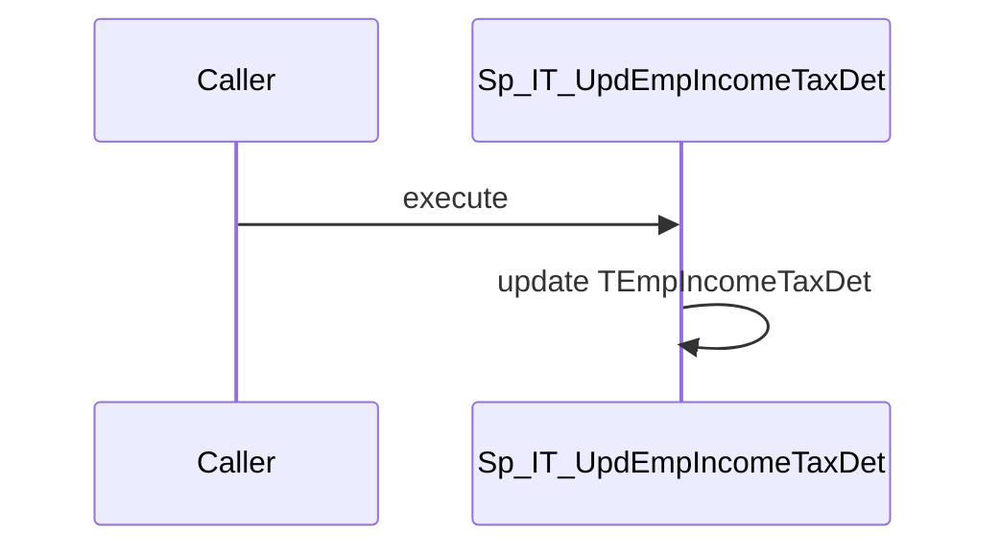
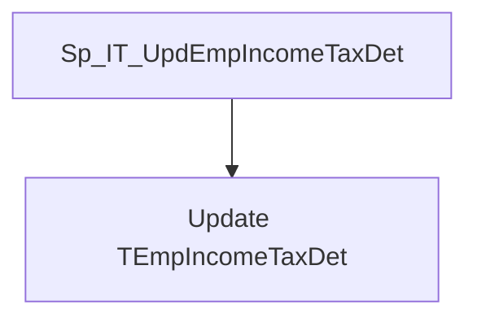

# Sp_IT_UpdEmpIncomeTaxDet

## What it does

Updates estimated/actual amounts and `ActualSubmitted` on one employee section-category row.

## Parameters

| Name | Direction | What it is for |
|---|---|---|
| `@Transid` | in | Row key |
| `@ActualAmount` | in | Actual amount |
| `@EstimatedAmount` | in | Estimated amount |
| `@ModifiedBy` | in | Modifying employee id |
| `@ActualSubmitted` | in | Optional; defaults to N; Submit path sends Y |

## Call sequence

Calls no other procedures or functions.

## Callers

No other procedure or function calls this object. Application caller: Core Node `IncomeTaxDeclarationDAL` update helpers used by `UpdateITDeclaration`.

## Nested

Calls no other procedures or functions.

## Steps

1. Script is `HRMS-DATABASE/HRMS/STOREPROCEDURE/Sp_IT_UpdEmpIncomeTaxDet.sql`.
2. Update `TEmpIncomeTaxDet` where `Transid` equals `@Transid`.
3. Sets `ModifiedDate = Getdate()` (and the modified-by / amount columns from parameters).

## Tables

| Table | Read or write |
|---|---|
| `dbo.TEmpIncomeTaxDet` | write |

## Flow

