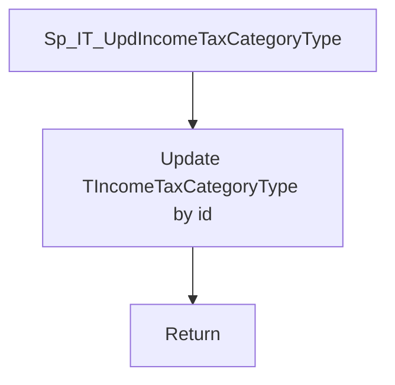

# Sp_IT_UpdIncomeTaxCategoryType

## What it does

Updates a category-type row by `IncomeTaxCategoryTypeId`: parent section, name, active flag, and modifier. Used by PayRoll Setup Masters Manage Category Types Update.

## Parameters

| Name | Direction | What it is for |
|---|---|---|
| `@CategoryTypeId` | in | `TIncomeTaxCategoryType.IncomeTaxCategoryTypeId` |
| `@SectionId` | in | New parent section id |
| `@CategoryTypeName` | in | New type name |
| `@IsAtive` | in | Active flag (`Y`/`N`); parameter spelling matches DAL |
| `@ModifiedBy` | in | Employee id of the modifier |

## Call sequence

Calls no other procedures or functions.

## Callers

| Object | Kind | Page |
|---|---|---|
| `IncomeTaxDeclarationDAL.UpdateCategoryTypes` | app | [Setup Masters](/docs/guides/payroll/setup-masters) via `POST /IncomeTax/UpdateCategoryTypes` |

No other procedure in `STOREPROCEDURE/` executes it.

## Nested

Calls no other procedures or functions.

## Steps

1. Script is `HRMS-DATABASE/HRMS/STOREPROCEDURE/Sp_IT_UpdIncomeTaxCategoryType.sql`.
2. `UPDATE TIncomeTaxCategoryType` set section, name, active, modifier, `ModifiedDate = GETDATE()` where id matches.

## Tables

| Table | Read or write |
|---|---|
| `dbo.TIncomeTaxCategoryType` | write |

## Unresolved calls

None.

## Flow

