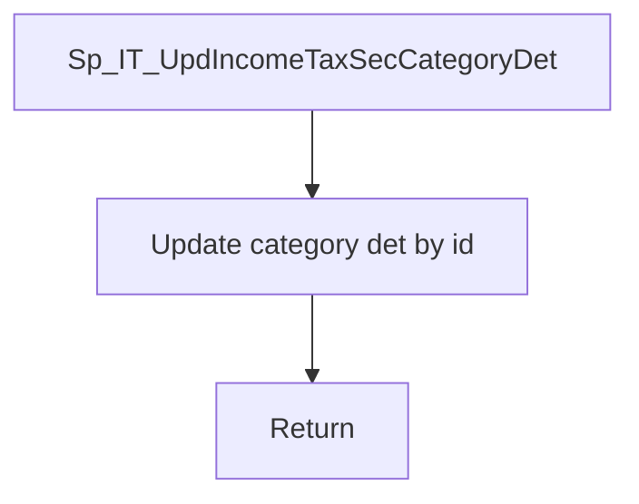

# Sp_IT_UpdIncomeTaxSecCategoryDet

## What it does

Updates a category detail row by `IncomeTaxSecDetId`: name, category type, limit, amount, active flag, and modifier. `@SectionId` is accepted but not applied to `IncomeTaxSecId`. Used by PayRoll Setup Masters Manage Categories Update.

## Parameters

| Name | Direction | What it is for |
|---|---|---|
| `@IncomeTaxSecDetId` | in | Row to update |
| `@SectionId` | in | Passed by DAL; not written to the row |
| `@CateoryName` | in | Category name; parameter spelling matches DAL |
| `@CategoryType` | in | Category type id |
| `@Limit` | in | Limit flag (`Y`/`N`) |
| `@Amount` | in | Category amount |
| `@IsAtive` | in | Active flag (`Y`/`N`); parameter spelling matches DAL |
| `@ModifiedBy` | in | Employee id of the modifier |

## Call sequence

Calls no other procedures or functions.

## Callers

| Object | Kind | Page |
|---|---|---|
| `IncomeTaxDeclarationDAL.UpdateCategories` | app | [Setup Masters](/docs/guides/payroll/setup-masters) via `POST /IncomeTax/UpdateCategories` |

No other procedure in `STOREPROCEDURE/` executes it.

## Nested

Calls no other procedures or functions.

## Steps

1. Script is `HRMS-DATABASE/HRMS/STOREPROCEDURE/Sp_IT_UpdIncomeTaxSecCategoryDet.sql`.
2. `UPDATE TIncomeTaxSectionCategoryDet` set name, type, limit, amount, active, modifier, `ModifiedDate = GETDATE()` where `IncomeTaxSecDetId` matches. Section FK is unchanged.

## Tables

| Table | Read or write |
|---|---|
| `dbo.TIncomeTaxSectionCategoryDet` | write |

## Unresolved calls

None.

## Flow

