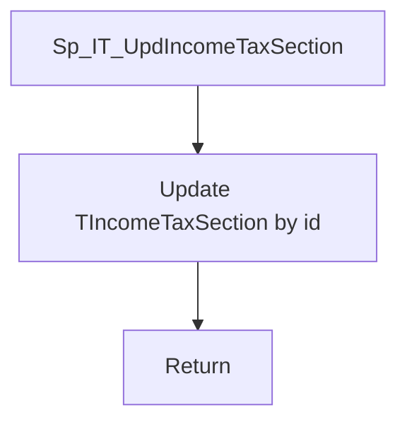

# Sp_IT_UpdIncomeTaxSection

## What it does

Updates an existing income-tax section by `IncomeTaxSecId`: name, limit, amount, active flag, and modifier. `@EmployerId` is accepted but not used in the `UPDATE` predicate. Used by PayRoll Setup Masters Manage Sections Update.

## Parameters

| Name | Direction | What it is for |
|---|---|---|
| `@IncomeTaxSecId` | in | Row to update |
| `@EmployerId` | in | Passed by DAL; not used in WHERE |
| `@SectionName` | in | New section name |
| `@Limit` | in | Limit flag (`Y`/`N`) |
| `@Amount` | in | Section amount |
| `@IsAtive` | in | Active flag (`Y`/`N`); parameter spelling matches DAL |
| `@ModifiedBy` | in | Employee id of the modifier |

## Call sequence

Calls no other procedures or functions.

## Callers

| Object | Kind | Page |
|---|---|---|
| `IncomeTaxDeclarationDAL.UpdateSections` | app | [Setup Masters](/docs/guides/payroll/setup-masters) via `POST /IncomeTax/IncomeTaxSectionUpdate` |

No other procedure in `STOREPROCEDURE/` executes it.

## Nested

Calls no other procedures or functions.

## Steps

1. Script is `HRMS-DATABASE/HRMS/STOREPROCEDURE/Sp_IT_UpdIncomeTaxSection.sql`.
2. `UPDATE TIncomeTaxSection` set name, limit, amount, active, modifier, `ModifiedDate = GETDATE()` where `IncomeTaxSecId = @IncomeTaxSecId`.

## Tables

| Table | Read or write |
|---|---|
| `dbo.TIncomeTaxSection` | write |

## Unresolved calls

None.

## Flow

