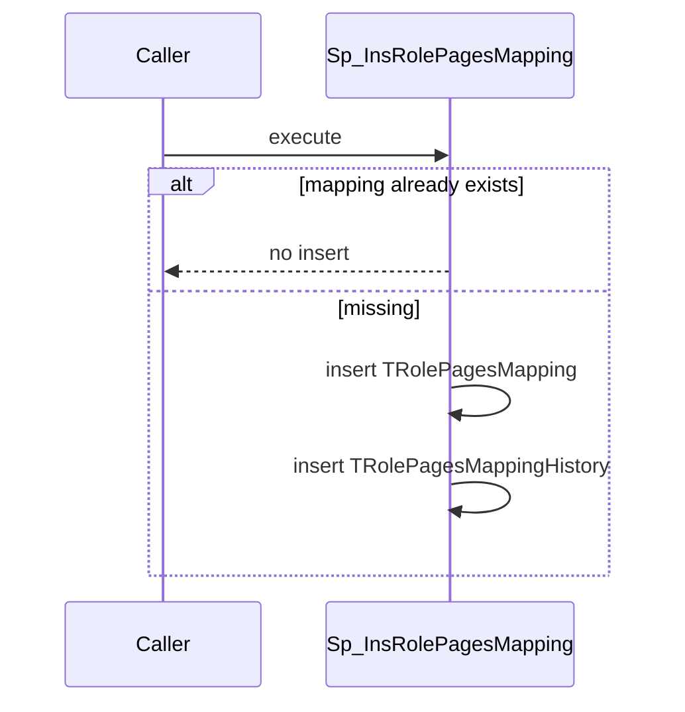
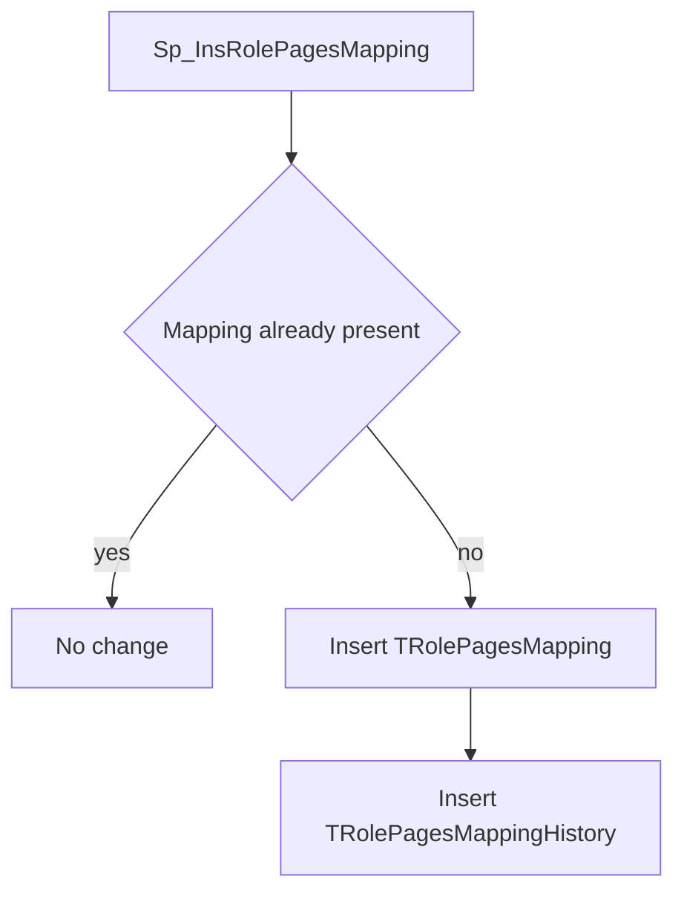

# Sp_InsRolePagesMapping

## What it does

Grants a role page access for one employer when that mapping is missing. When it inserts, it also writes a history row to `TRolePagesMappingHistory` for that employer.

Menu Manager Tab Manager calls this for the selected page and each ancestor menu id so a granted tab remains reachable in the nav.

## Parameters

| Name | Direction | What it is for |
|---|---|---|
| `@RoleId` | in | Role receiving the page |
| `@PageId` | in | Page id (menu id) |
| `@EmployerId` | in | Employer for the mapping |
| `@CreatedBy` | in | Actor stamped on the live and history rows |

## Call sequence

## Callers

No other procedure or function calls this object. `MenuManagerDAL.insertRolePageMappingIfMissing` executes it from Tab Manager save (`POST /api/menuManagement/tabAccess`).

## Nested

Calls no other procedures or functions.

## Steps

1. In `HRMS-DATABASE/HRMS/STOREPROCEDURE/Sp_InsRolePagesMapping.sql`, check `TRolePagesMapping` for an existing row on `@RoleId`, `@PageId`, and `@EmployerId`.
2. When none exists, compute the next `Transid` as `max(TRansid)+1` from `TRolePagesMappingHistory` for that employer.
3. Insert `TRolePagesMapping` with `@CreatedBy`, `GETDATE()`, and `GETUTCDATE()`.
4. Insert matching `TRolePagesMappingHistory`.

## Tables

| Table | Read or write |
|---|---|
| `dbo.TRolePagesMapping` | read, write |
| `dbo.TRolePagesMappingHistory` | read, write |

## Unresolved calls

None.

## Flow

