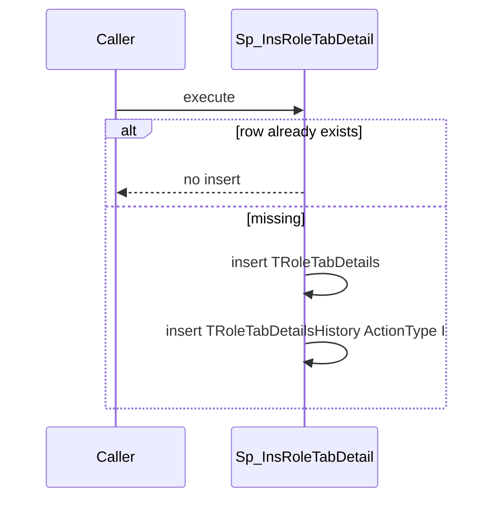
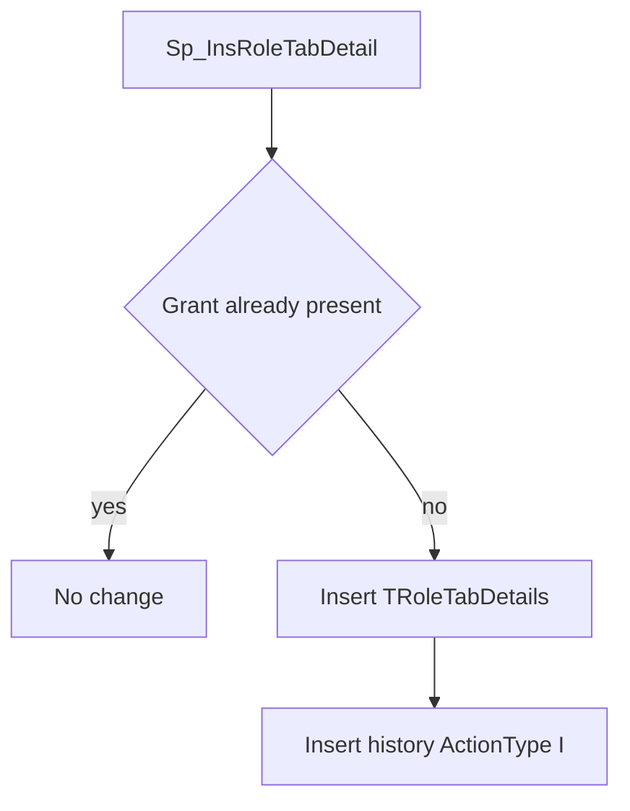

# Sp_InsRoleTabDetail

## What it does

Grants a role access to one tab on one menu for one employer, if that grant does not already exist. When it inserts, it also writes an insert history row to `TRoleTabDetailsHistory` with `ActionType` `I` and `IsEditable` `Y`.

## Parameters

| Name | Direction | What it is for |
|---|---|---|
| `@RoleId` | in | Role receiving the tab |
| `@MenuId` | in | Menu (page) that owns the tab |
| `@TabId` | in | Base-organisation tab id |
| `@EmployerId` | in | Employer for the grant |
| `@CreatedBy` | in | Actor stamped on the live and history rows |

## Call sequence

## Callers

No other procedure or function calls this object. `MenuManagerDAL.insertRoleTabDetailIfMissing` executes it from Tab Manager save (`POST /api/menuManagement/tabAccess`).

## Nested

Calls no other procedures or functions.

## Steps

1. In `HRMS-DATABASE/HRMS/STOREPROCEDURE/Sp_InsRoleTabDetail.sql`, check `TRoleTabDetails` for an existing row on `@RoleId`, `@MenuId`, `@TabId`, and `@EmployerId`.
2. When none exists, compute the next `TransId` as `max(TransId)+1` from `TRoleTabDetailsHistory`.
3. Insert `TRoleTabDetails` with `IsEditable` `Y`, `@CreatedBy`, and today's date.
4. Insert matching `TRoleTabDetailsHistory` with `ActionType` `I`.

## Tables

| Table | Read or write |
|---|---|
| `dbo.TRoleTabDetails` | read, write |
| `dbo.TRoleTabDetailsHistory` | read, write |

## Unresolved calls

None.

## Flow

