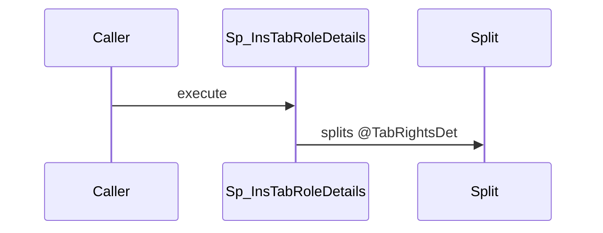
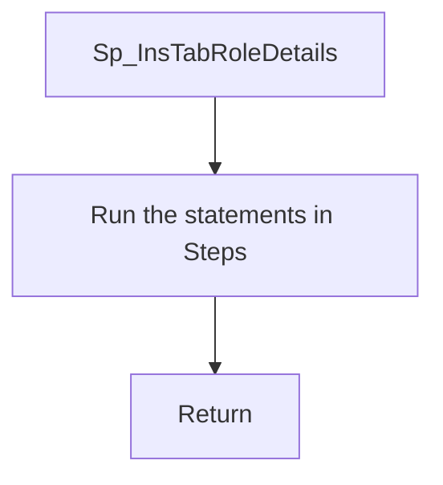

# Sp_InsTabRoleDetails

## What it does

Replaces a role's tab rights. It archives the current TRoleTabDetails rows as action D, deletes them, and inserts one row per MenuId~TabId~IsEditable token, also archived as action I.

## Parameters

| Name | Direction | What it is for |
|---|---|---|
| `@RoleId` | in | Role |
| `@TabRightsDet` | in | Comma-separated MenuId~TabId~IsEditable tokens. Empty skips the body |
| `@TransId` | in | History transaction id |
| `@EmployerId` | in | Employer |
| `@CreatedBy` | in | Employee id on the new rows |

## Call sequence

## Callers

| Object | Kind | Page |
|---|---|---|
| `SP_AdminRoleM_InsRolePageMapping` | procedure | [SP_AdminRoleM_InsRolePageMapping](/docs/database/hrms/SP_AdminRoleM_InsRolePageMapping) |
| `SP_AdminRoleM_InsRoles` | procedure | [SP_AdminRoleM_InsRoles](/docs/database/hrms/SP_AdminRoleM_InsRoles) |
| `SP_AdminRoleM_UpdRoles` | procedure | [SP_AdminRoleM_UpdRoles](/docs/database/hrms/SP_AdminRoleM_UpdRoles) |
| `SP_ApproveAdminChangesRequest` | procedure | No page yet |
| `SP_CM_ApproveAdminChangesRequest` | procedure | No page yet |
| `SP_InsertRolePageMapping` | procedure | No page yet |

## Nested

| Object | Kind | When | Page |
|---|---|---|
| `Split` | function | splits @TabRightsDet | [Split](/docs/database/hrms/Split) |

## Steps

1. When @TabRightsDet is empty, do nothing.
2. Copy current TRoleTabDetails into TRoleTabDetailsHistory with action D, then delete those rows.
3. Split the string and, for each token, parse menu id, tab id, and the editable flag. Tab id 0 is stored as null.
4. Insert TRoleTabDetails and a matching history row with action I.

## Tables

| Table | Read or write |
|---|---|
| `TRoleTabDetails` | read and write |
| `TRoleTabDetailsHistory` | write |

## Flow

