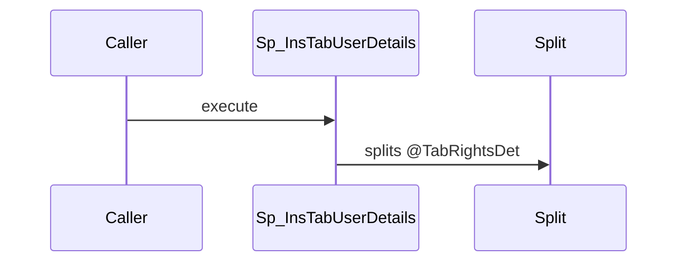
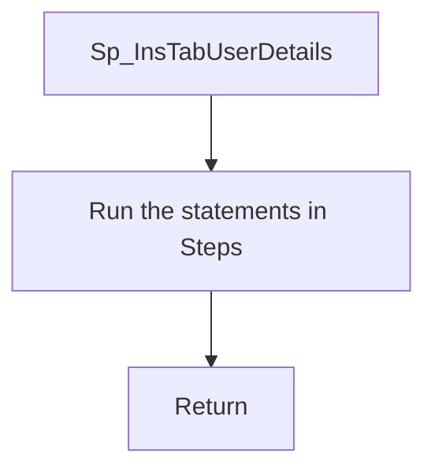

# Sp_InsTabUserDetails

## What it does

Replaces one user's tab rights using the same archive, delete, and insert pattern as the role version.

## Parameters

| Name | Direction | What it is for |
|---|---|---|
| `@UserId` | in | User |
| `@TabRightsDet` | in | Comma-separated MenuId~TabId~IsEditable tokens. Empty skips the body |
| `@TransId` | in | History transaction id |
| `@EmployerId` | in | Employer |
| `@CreatedBy` | in | Employee id on the new rows |

## Call sequence

## Callers

| Object | Kind | Page |
|---|---|---|
| `SP_AdminRoleM_InsUserPageMap` | procedure | [SP_AdminRoleM_InsUserPageMap](/docs/database/hrms/SP_AdminRoleM_InsUserPageMap) |
| `SP_ApproveAdminChangesRequest` | procedure | No page yet |
| `SP_CM_ApproveAdminChangesRequest` | procedure | No page yet |
| `SP_InsertUserPageMapping` | procedure | No page yet |

## Nested

| Object | Kind | When | Page |
|---|---|---|
| `Split` | function | splits @TabRightsDet | [Split](/docs/database/hrms/Split) |

## Steps

1. When @TabRightsDet is empty, do nothing.
2. Copy TUserTabDetails into TUserTabDetailsHistory with action D and delete the current rows.
3. Split the tokens, store tab id 0 as null, and insert TUserTabDetails plus a history row with action I.

## Tables

| Table | Read or write |
|---|---|
| `TUserTabDetails` | read and write |
| `TUserTabDetailsHistory` | write |

## Flow

