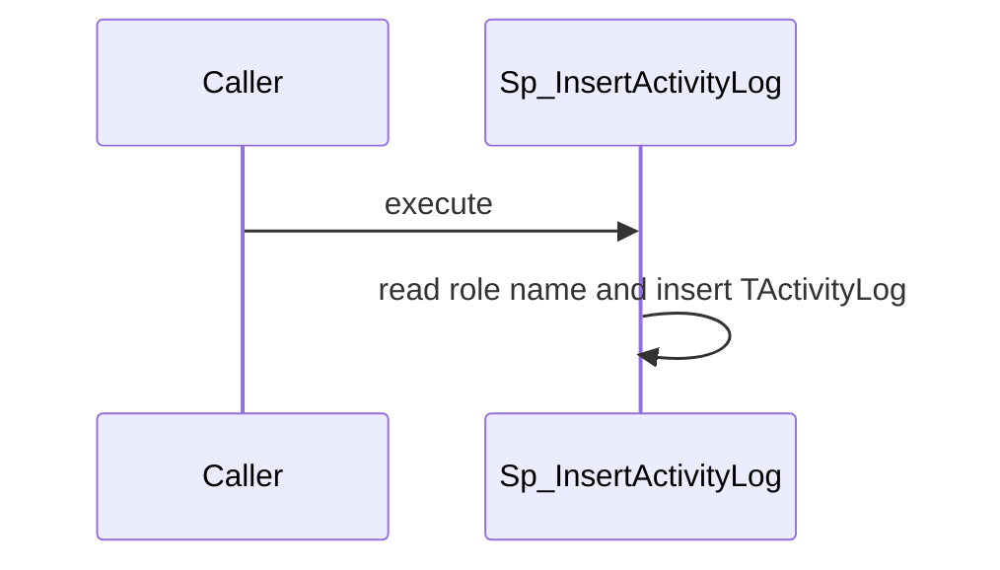
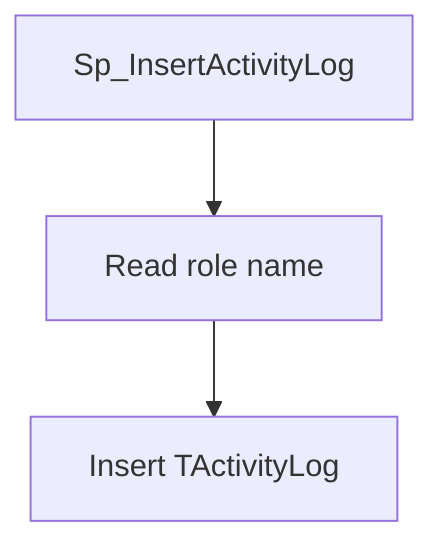

# Sp_InsertActivityLog

## What it does

Inserts one activity-log row for an employee. The role name is looked up from the employee's user and stored on the same row. View Organization Chart calls it on every load of `OrganizationChart.aspx` with activity type 311.

## Parameters

| Name | Direction | What it is for |
|---|---|---|
| `@ActivityTypeId` | in | Activity catalog id. This screen sends 311 |
| `@EmployeeId` | in | Employee the log is attributed to. The WebForms helper sends the session employee, or 0 when the session is missing |
| `@LoggedDate` | in | Time of the activity. The helper sends UTC now |
| `@IPAddress` | in | Caller IP |
| `@Browser` | in | Browser name. Edge is rewritten to `Microsoft Edge` before the call |
| `@UserName` | in | Display name stored on the row |
| `@Comments` | in | Optional text. Default null. This screen does not pass comments |
| `@HostName` | in | Optional host. Default null. This screen does not pass a host |

## Call sequence

Calls no other procedures or functions.

## Callers

| Object | Kind | Page |
|---|---|---|
| `ActivityHelper.LogActivity` | app | [View Organization Chart](/docs/guides/admin-configuration/view-organization-chart) and any other page that calls `CommonUtil.LogActivity` |
| `recruitmentDAL.js`, `recruitmentDAL_V2.js`, `recruitmentDAL_V3.js` | app | Commented-out `.execute("Sp_InsertActivityLog")` only |

No other procedure in `STOREPROCEDURE/` executes it.

## Nested

None.

## Steps

In `HRMS-DATABASE/HRMS/STOREPROCEDURE/Sp_InsertActivityLog.sql`:

1. Read `RoleName` from `TRoles` for the `RoleID` on `TUsers`, joined through `TUserEmployee.EmployeeID = @EmployeeId`.
2. Insert `TActivityLog` with the input columns plus that role name.

When the employee has no user, the role subquery returns no row and `UserRole` is inserted as null. The insert still runs.

## Tables

| Table | Read or write |
|---|---|
| `dbo.TUserEmployee` | read |
| `dbo.TUsers` | read |
| `dbo.TRoles` | read |
| `dbo.TActivityLog` | write |

## Flow

