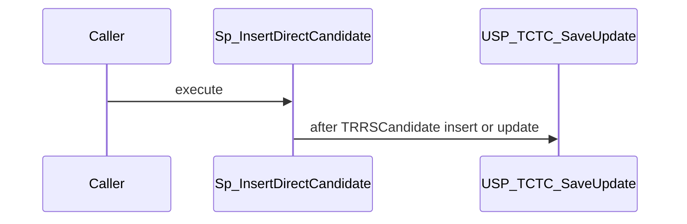
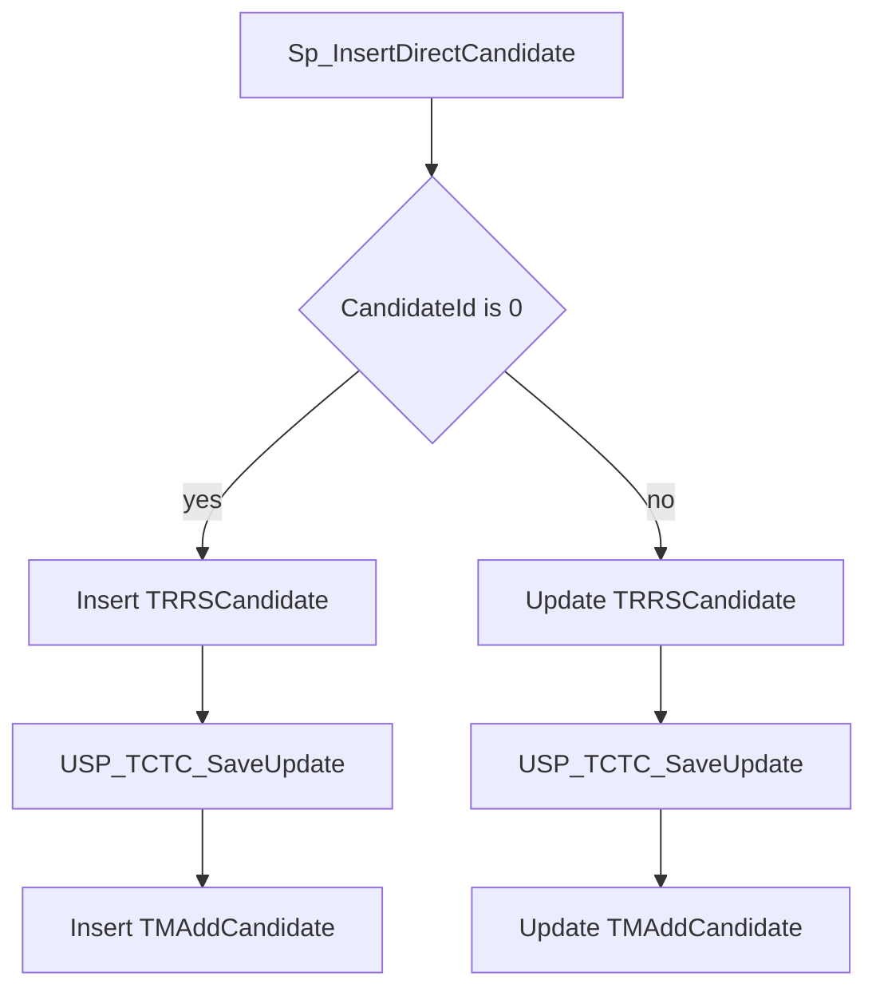

# Sp_InsertDirectCandidate

## What it does

Inserts or updates a direct (Offer Rolled Out) candidate. New rows write both `TRRSCandidate` (`DirectCandidate = 1`) and `TMAddCandidate`, then save CTC via `USP_TCTC_SaveUpdate`. Updates refresh both tables and CTC; when status is `Offered`, the existing `TRRSCandidate.Status` is preserved.

## Parameters

| Name | Direction | What it is for |
|---|---|---|
| `@CandidateId` | in | Null/0 = insert; else update |
| `@FirstName` / `@LastName` / `@Address` / `@EmailId` | in | Identity and contact |
| `@PanNo` / `@AddharNo` | in | Identity numbers on `TMAddCandidate` |
| `@ExpectedDOJ` | in | Expected joining / DOJ |
| `@Designation` / `@OfficeLocation` / `@ReportingTime` | in | Offer placement |
| `@AnnualCTC` / `@MonthlyCTC` / `@MonthlyInHandCTC` | in | Encrypted CTC strings |
| `@OfferLetterId` / `@SalaryBreakUpPath` / `@OfferLetterPath` / `@OtherDocumentPath` | in | Template and document paths |
| `@LoggedInUser` / `@EmployerId` | in | Audit and tenant |
| `@CandidateStatus` / `@Comments` | in | Status and comments |
| `@WorkLocationId` / `@BaseLocationId` / `@ReportingManagerEmployeeId` / `@BusinessUnitId` | in | Optional org placement |

## Call sequence

## Callers

No other procedure or function calls this object.

## Nested

| Object | Kind | When | Page |
|---|---|---|---|
| `USP_TCTC_SaveUpdate` | procedure | after insert or update of `TRRSCandidate` | [USP_TCTC_SaveUpdate](/docs/database/hrms/USP_TCTC_SaveUpdate) |

## Steps

1. If `@CandidateId` is null/0: insert `TRRSCandidate` with `DirectCandidate = 1`, capture identity, call `USP_TCTC_SaveUpdate` with `@CurrentCTC`, insert matching `TMAddCandidate`, return `CandidateId`.
2. Else: update `TRRSCandidate` (keep status when incoming status is `Offered`), call `USP_TCTC_SaveUpdate`, update `TMAddCandidate`, return `@CandidateId`.

## Tables

| Table | Read or write |
|---|---|
| `TRRSCandidate` | write |
| `TMAddCandidate` | write |
| `TCTC` | write via `USP_TCTC_SaveUpdate` |

## Flow

