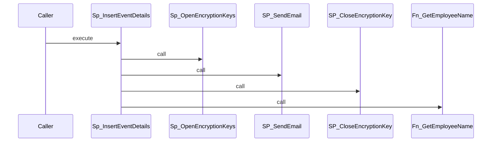
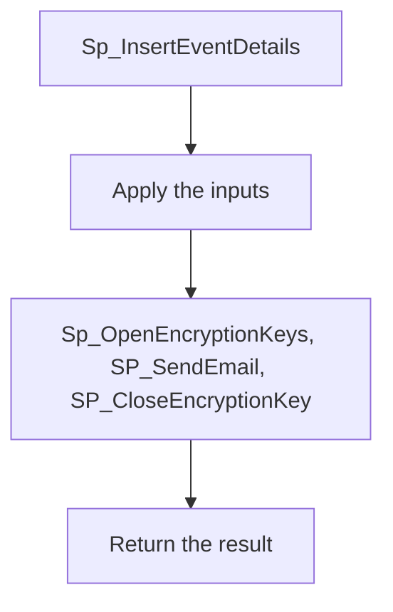

# Sp_InsertEventDetails

## What it does

Sends a birthday or work-anniversary wish. It fills the employer event template with the sender's name and the message, then hands the mail to the email procedure.

## Parameters

| Name | Direction | What it is for |
|---|---|---|
| `@EventType` | in | Birthday or work anniversary (`Varchar(50)`) |
| `@Employerid` | in | Employer that owns the data (`Int`) |
| `@ToEmployeeId` | in | Employee who receives the wish (`Int`) |
| `@FromEmployeeId` | in | Employee who sends the wish (`Int`) |
| `@WishMessage` | in | Wish text typed in the header (`Varchar(Max)`) |

## Call sequence

## Callers

No other procedure or function under STOREPROCEDURE or FUNCTIONS executes this object.

## Nested

| Object | Kind | When | Page |
|---|---|---|---|
| `Sp_OpenEncryptionKeys` | procedure | Called while this object runs | [Sp_OpenEncryptionKeys](/docs/database/hrms/Sp_OpenEncryptionKeys) |
| `SP_SendEmail` | procedure | Called while this object runs | No page yet |
| `SP_CloseEncryptionKey` | procedure | Called while this object runs | [SP_CloseEncryptionKey](/docs/database/hrms/SP_CloseEncryptionKey) |
| `Fn_GetEmployeeName` | function | Called while this object runs | [Fn_GetEmployeeName](/docs/database/hrms/Fn_GetEmployeeName) |

## Steps

In `HRMS-DATABASE/HRMS/STOREPROCEDURE/Sp_InsertEventDetails.sql`:

1. Sends a birthday or work-anniversary wish.
2. It fills the employer event template with the sender's name and the message, then hands the mail to the email procedure.

## Tables

| Table | Read or write |
|---|---|
| `TEmployerDetails` | read |
| `TEmployee` | read |
| `Tevents` | read |

## Flow

