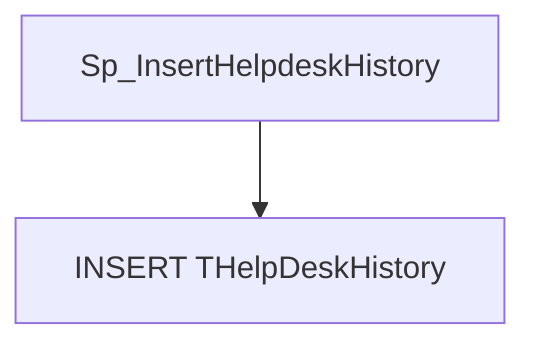

# Sp_InsertHelpdeskHistory

## What it does

Inserts one THelpDeskHistory row capturing the help-desk snapshot and ActionType from insert or update callers.

## Parameters

| Name | Direction | What it is for |
|---|---|---|
| `@HelpdeskRequestId` | in | Parent request |
| `@EmployeeId` | in | Owner list or employee string |
| `@SupportDocument / @RequestDetails / @HRComments / @RequestStatus` | in | Snapshot fields |
| `@CreatedBy / @HistoryCreatedBy` | in | Actors |
| `@EmployerId` | in | Employer |
| `@HD_GroupID / @HD_CategoryID / @HD_ActivityID / @RequestedFor` | in | Tree snapshot |
| `@ActionType` | in | I or update marker |

## Call sequence

Calls nested procedures listed under Nested when present; otherwise runs inline SQL only.

## Callers

| Object | Kind |
|---|---|
| `SP_InsertHelpdeskRequest` | procedure |
| `SP_UpdateHelpdeskRequest` | procedure |

## Nested

Calls no other procedures or functions.

## Steps

1. INSERT one row into THelpDeskHistory.

## Tables

| Table | Read or write |
|---|---|
| `THelpDeskHistory` | write |

## Unresolved calls

None noted for this feature pass.

## Flow

