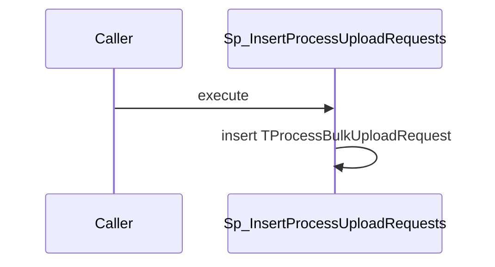
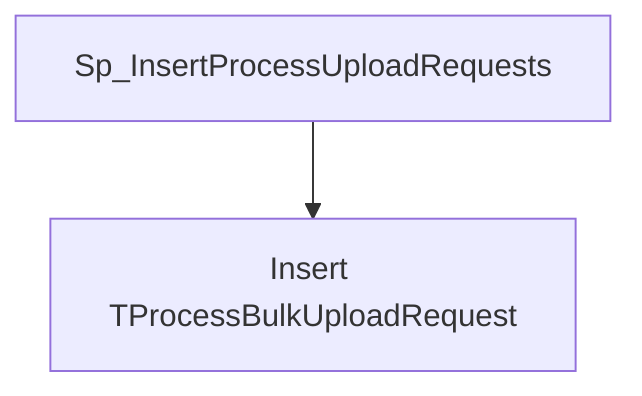

# Sp_InsertProcessUploadRequests

## What it does

Inserts one `TProcessBulkUploadRequest` queue row for a Client Onboarding upload request. Downstream SSIS / jobs use that row to promote validated staging data. The procedure does not update `TBulkUploadRequests` itself.

## Parameters

| Name | Direction | What it is for |
|---|---|---|
| `@RequestId` | in | Upload request to process |
| `@EmployerId` | in | Organisation stored on the process row |
| `@CreatedBy` | in | User who requested processing |

## Call sequence

Calls no other procedures or functions.

## Callers

Procedures and functions that call this object.

| Caller | Kind | When |
|---|---|---|
| `Sp_RequestForValidateUploads` | procedure | Partial-process path after Validate |

App callers: `bulkUploadDAL.InsertProcessRequests` (Process button) and nested from Validate when `IsPartiallyDataProcess` is set, from Upload Files.

## Nested

| Object | Kind | When | Page |
|---|---|---|---|
| *(none)* | — | — | — |

## Steps

1. Script is `HRMS-DATABASE/HRMS/STOREPROCEDURE/Sp_InsertProcessUploadRequests.sql`.
2. Insert `RequestId`, `CreatedBy`, `GETDATE()`, and `EmployerId` into `TProcessBulkUploadRequest`.

## Tables

| Table | Read or write |
|---|---|
| `dbo.TProcessBulkUploadRequest` | write |

## Unresolved calls

None.

## Flow

