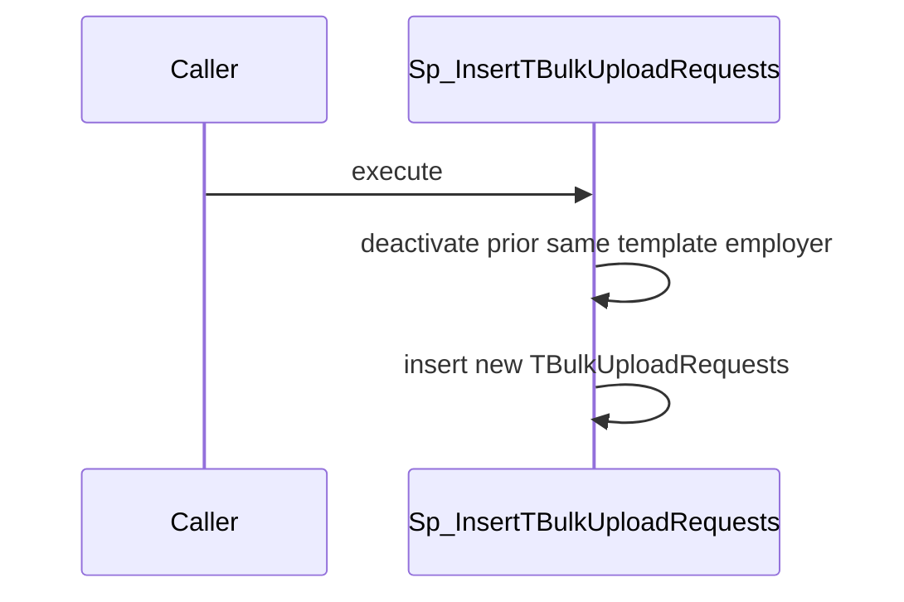
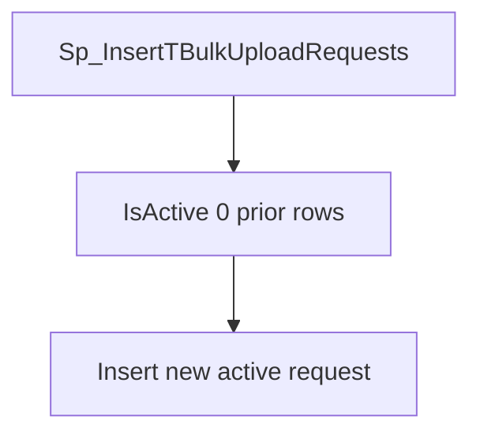

# Sp_InsertTBulkUploadRequests

## What it does

Queues one Client Onboarding upload request. It soft-deactivates any prior request for the same template and employer (`IsActive = 0`), then inserts a new active `TBulkUploadRequests` row with the uploaded file path and partial-process flag.

## Parameters

| Name | Direction | What it is for |
|---|---|---|
| `@EmployeeId` | in | Creator stored as `CreatedBy` |
| `@EmployerId` | in | Organisation for the request |
| `@UploadTemplateId` | in | Template from `TBulkUplaodTemplateMaster` |
| `@UploadedFilePath` | in | Server path of the uploaded `.xls` |
| `@IsPartiallyDataProcess` | in | When true, validate may also enqueue process |

## Call sequence

Calls no other procedures or functions.

## Callers

Procedures and functions that call this object.

No other procedure or function calls this object. App caller: `bulkUploadDAL.InsertUploadRequest` from Upload Files (`UploadFiles.aspx`).

## Nested

| Object | Kind | When | Page |
|---|---|---|---|
| *(none)* | — | — | — |

## Steps

1. Script is `HRMS-DATABASE/HRMS/STOREPROCEDURE/Sp_InsertTBulkUploadRequests.sql`.
2. `UPDATE TBulkUploadRequests SET IsActive = 0` for matching `@UploadTemplateId` and `@EmployerId`.
3. Insert one row with template, creator, `GETDATE()`, employer, file path, `IsActive = 1`, and `@IsPartiallyDataProcess`.

## Tables

| Table | Read or write |
|---|---|
| `dbo.TBulkUploadRequests` | write |

## Unresolved calls

None.

## Flow

