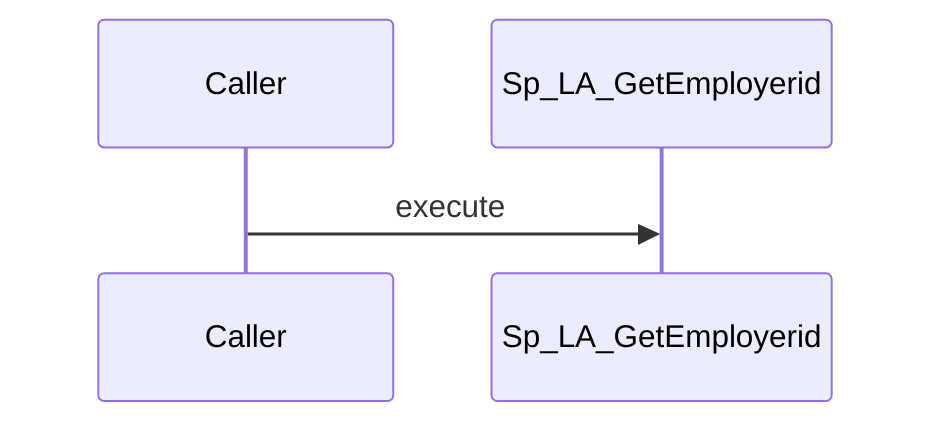
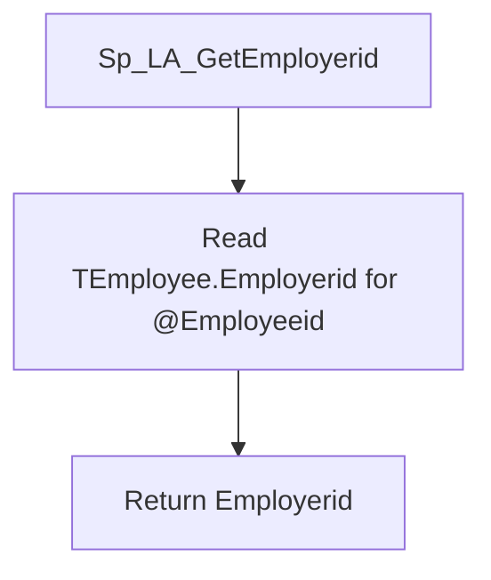

# Sp_LA_GetEmployerid

## What it does

Returns the `Employerid` for one employee from `TEmployee`. Self Attestation uses it before checking whether a Policy Document Sign-Off Confirmation workflow exists.

## Parameters

| Name | Direction | What it is for |
|---|---|---|
| `@Employeeid` | in | Employee whose employer id is returned (`Int`) |

## Call sequence

Calls no other procedures or functions.

## Callers

No other procedure or function under STOREPROCEDURE or FUNCTIONS executes this object. Application callers include `CommonDAL.GetEmployerId`.

## Nested

Calls no other procedures or functions.

## Steps

In `HRMS-DATABASE/HRMS/STOREPROCEDURE/Sp_LA_GetEmployerid.sql`:

1. Select `Employerid` from `TEmployee` where `EmployeeId` equals `@Employeeid`.
2. Return that scalar result set to the caller.

## Tables

| Table | Read or write |
|---|---|
| `TEmployee` | read |

## Flow

