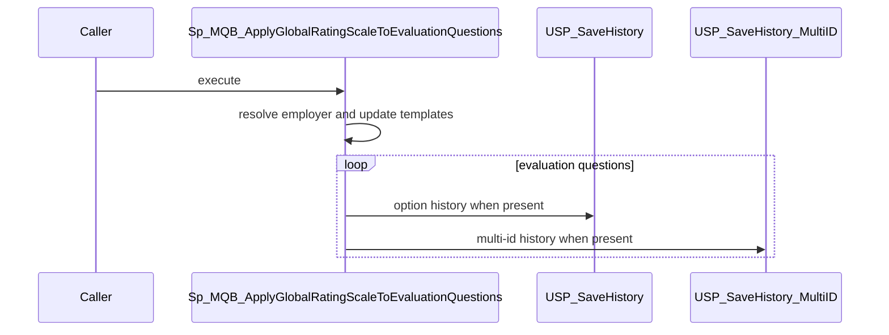
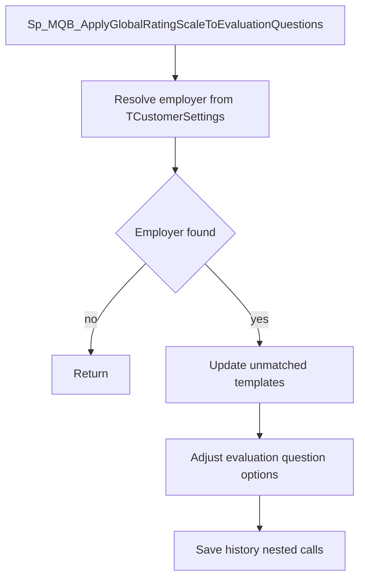

# Sp_MQB_ApplyGlobalRatingScaleToEvaluationQuestions

## What it does

Propagates a Fixed Global Rating Scale change to Post-Training-Evaluation questions for one customer. It resolves the employer and rating type from `TCustomerSettings`, updates unmatched evaluation templates, then walks Text / Star / Range rating questions and adjusts option counts to match `@pRatingValue`, writing history through `USP_SaveHistory` / `USP_SaveHistory_MultiID` where those paths run. Customer Config calls it after an LMS save when the fixed scale value changes.

## Parameters

| Name | Direction | What it is for |
|---|---|---|
| `@pCustomerId` | in | Customer number |
| `@pRatingValue` | in | New fixed rating scale value |
| `@pCreatedBy` | in | Actor employee id for history |

## Call sequence

## Callers

No other procedure or function calls this object. `ApplyGlobalRatingScale` executes it from Customer Config LMS save.

## Nested

| Object | Kind | When | Page |
|---|---|---|---|
| `USP_SaveHistory` | procedure | option history path | unresolved in this checkout (no `HRMS/STOREPROCEDURE/USP_SaveHistory.sql`) |
| `USP_SaveHistory_MultiID` | procedure | multi-id history path | [USP_SaveHistory_MultiID](/docs/database/hrms/USP_SaveHistory_MultiID) |

## Steps

1. In `HRMS-DATABASE/HRMS/STOREPROCEDURE/Sp_MQB_ApplyGlobalRatingScaleToEvaluationQuestions.sql`, resolve `@EmployerId` and `@RatingTypeId` from `TCustomerSettings`; return if missing.
2. Update unmatched `TEvaluationTemplate` rows for the root employer with the rating type and value.
3. Cursor over Post-Training-Evaluation questions (`QuesTypeCD` 161) with answer types Text / Star / Range that are not assigned evaluation questions.
4. For each question, adjust option rows to match `@pRatingValue` and write history via nested save-history procedures when those branches run.

## Tables

| Table | Read or write |
|---|---|
| `dbo.TCustomerSettings` | read |
| `dbo.TEvaluationTemplate` | write |
| `dbo.TTrainingEvaluationPhaseDetails` | read |
| `dbo.TQuestion` | read |
| `dbo.TEmployeeTrainingEvaluationQuestion` | read |
| `dbo.TEvaluationTemplateQuestion` | read |
| `dbo.TEvaluationTemplateSection` | read |
| `dbo.TQuestionOption` | read, write (via synonym resolution for history DB name) |

## Unresolved calls

- `USP_SaveHistory` — called from option history branches; procedure body not under `HRMS/STOREPROCEDURE` in this checkout.

## Flow

