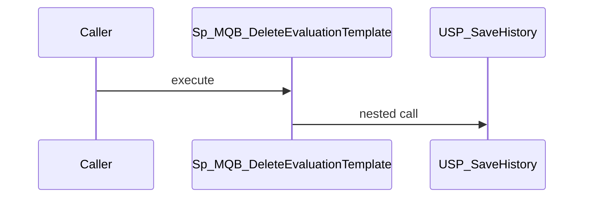
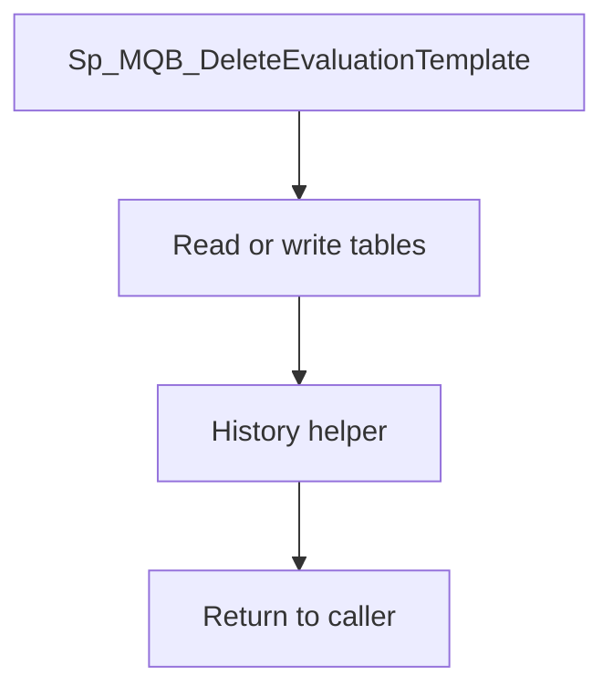

# Sp_MQB_DeleteEvaluationTemplate

## What it does

Soft-deletes an evaluation template when allowed.

## Parameters

| Name | Direction | What it is for |
|---|---|---|
| `@pEvaluationTemplateId` | in | INT |
| `@pDeletedBy` | in | INT (default -1) |

## Call sequence

## Callers

No other procedure or function in the Master Question Bank direct set calls this object.

Application code may call it through `masterQuestionBankDAL`.

## Nested

| Object | Kind | When | Page |
|---|---|---|---|
| `USP_SaveHistory` | procedure | on the script path that reaches this call | No page yet |

## Steps

1. Updates matching rows when the script path is an update or soft-delete.
2. Calls history helper(s) after the primary write.

## Tables

| Table | Read or write |
|---|---|
| `TEvaluationTemplate` | write |
| `sys` | read |
| `TEvaluationTemplateTraining` | read |

## Flow

