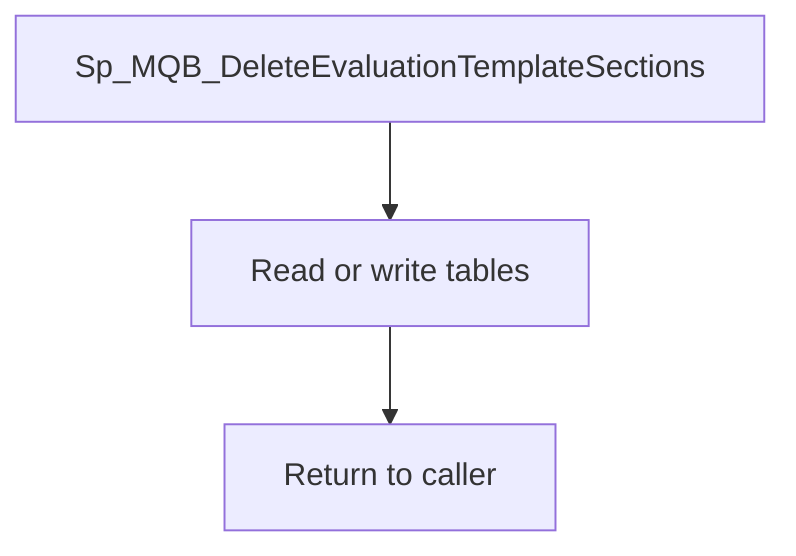

# Sp_MQB_DeleteEvaluationTemplateSections

## What it does

Soft-deletes sections and related mappings for a template.

## Parameters

| Name | Direction | What it is for |
|---|---|---|
| `@pEvaluationTemplateId` | in | INT |
| `@pDeletedBy` | in | INT (default -1) |

## Call sequence

Calls no other procedures or functions.

## Callers

No other procedure or function in the Master Question Bank direct set calls this object.

Application code may call it through `masterQuestionBankDAL`.

## Nested

Calls no other procedures or functions.

## Steps

1. Updates matching rows when the script path is an update or soft-delete.

## Tables

| Table | Read or write |
|---|---|
| `ETQ` | write |
| `TEvaluationTemplateSection` | read and write |
| `TEvaluationTemplateQuestion` | read |

## Flow

