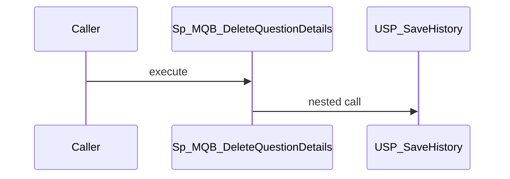
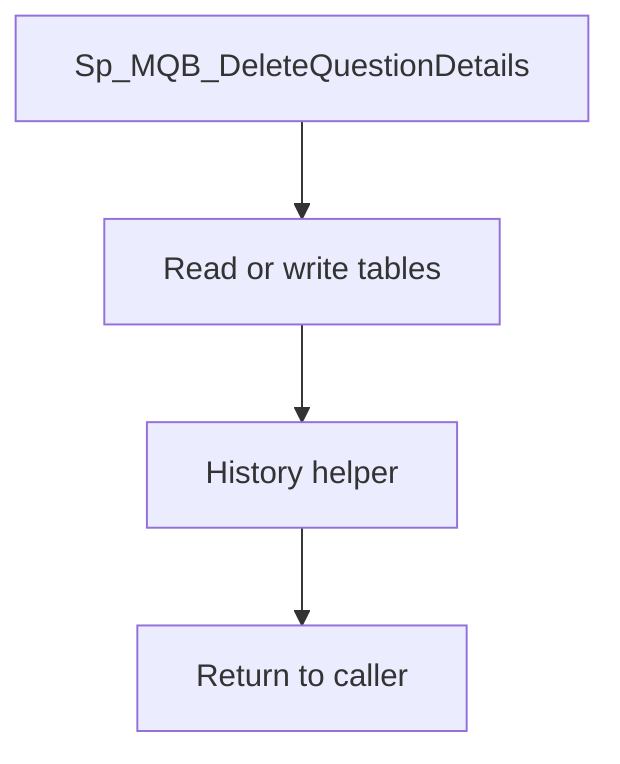

# Sp_MQB_DeleteQuestionDetails

## What it does

Soft-deletes a question after checking evaluation-template usage. When the question is only on inactive templates, removes those mappings and audits history.

## Parameters

| Name | Direction | What it is for |
|---|---|---|
| `@pQuestionId` | in | int |

## Call sequence

## Callers

No other procedure or function in the Master Question Bank direct set calls this object.

Application code may call it through `masterQuestionBankDAL`.

## Nested

| Object | Kind | When | Page |
|---|---|---|---|
| `USP_SaveHistory` | procedure | on the script path that reaches this call | No page yet |

## Steps

1. Opens a try block and begins a transaction when the script mutates data.
2. Inserts into the target table(s) listed under Tables.
3. Updates matching rows when the script path is an update or soft-delete.
4. Calls history helper(s) after the primary write.

## Tables

| Table | Read or write |
|---|---|
| `ETQ` | write |
| `TQuestion` | write |
| `sys` | read |
| `TEvaluationTemplateQuestion` | read |
| `etq_cursor` | read |
| `TEvaluationTemplateSection` | read |
| `TEvaluationTemplate` | read |

## Flow

