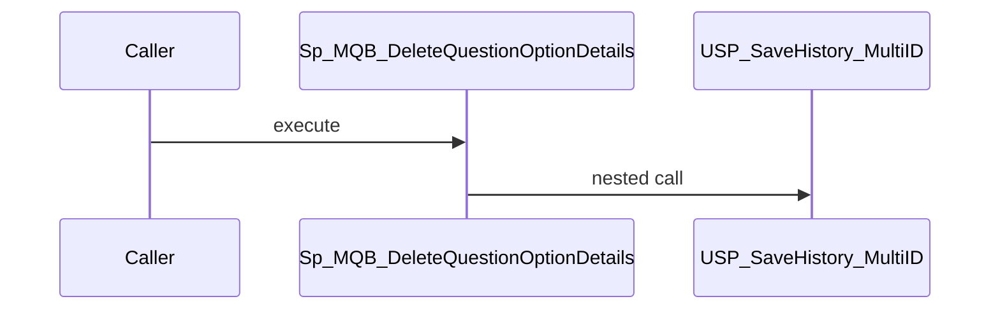
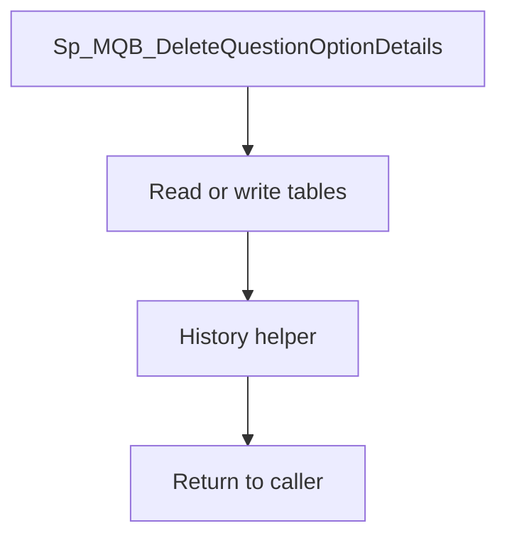

# Sp_MQB_DeleteQuestionOptionDetails

## What it does

Deletes question option rows by id list and writes multi-id history.

## Parameters

| Name | Direction | What it is for |
|---|---|---|
| `@pQuestionId` | in | INT |
| `@pQOptionIDs` | in | VARCHAR(500) |

## Call sequence

## Callers

No other procedure or function in the Master Question Bank direct set calls this object.

Application code may call it through `masterQuestionBankDAL`.

## Nested

| Object | Kind | When | Page |
|---|---|---|---|
| `USP_SaveHistory_MultiID` | procedure | on the script path that reaches this call | [USP_SaveHistory_MultiID](/docs/database/hrms/USP_SaveHistory_MultiID) |

## Steps

1. Deletes matching rows when the script path removes options or related data.
2. Calls history helper(s) after the primary write.
3. Selects and returns one or more result sets for the caller.

## Tables

| Table | Read or write |
|---|---|
| `TQuestionOption` | read and write |
| `STRING_SPLIT` | read |
| `sys` | read |

## Flow

