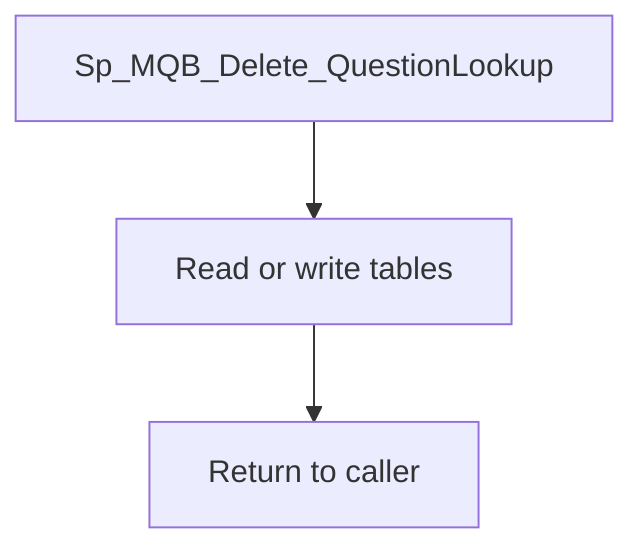

# Sp_MQB_Delete_QuestionLookup

## What it does

To insert Sp_TR_Delete_Lookup.sql data

## Parameters

| Name | Direction | What it is for |
|---|---|---|
| `@LookupID` | in | INT |
| `@pRId` | in | INT |

## Call sequence

Calls no other procedures or functions.

## Callers

No other procedure or function in the Master Question Bank direct set calls this object.

Application code may call it through `masterQuestionBankDAL`.

## Nested

Calls no other procedures or functions.

## Steps

1. Updates matching rows when the script path is an update or soft-delete.

## Tables

| Table | Read or write |
|---|---|
| `TQuestion_LOOKUP` | write |

## Flow

