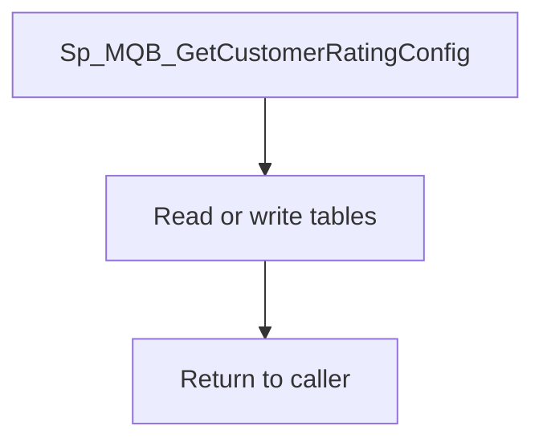

# Sp_MQB_GetCustomerRatingConfig

## What it does

Returns rating type and value from customer settings.

## Parameters

| Name | Direction | What it is for |
|---|---|---|
| `@pEmployerId` | in | INT (default NULL) |
| `@pCustomerId` | in | VARCHAR(25) (default NULL) |

## Call sequence

Calls no other procedures or functions.

## Callers

No other procedure or function in the Master Question Bank direct set calls this object.

Application code may call it through `masterQuestionBankDAL`.

## Nested

Calls no other procedures or functions.

## Steps

1. Selects and returns one or more result sets for the caller.

## Tables

| Table | Read or write |
|---|---|
| `TCustomerSettings` | read |

## Flow

