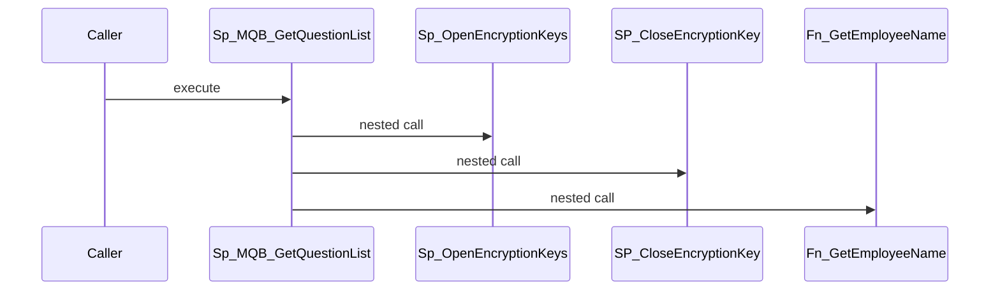
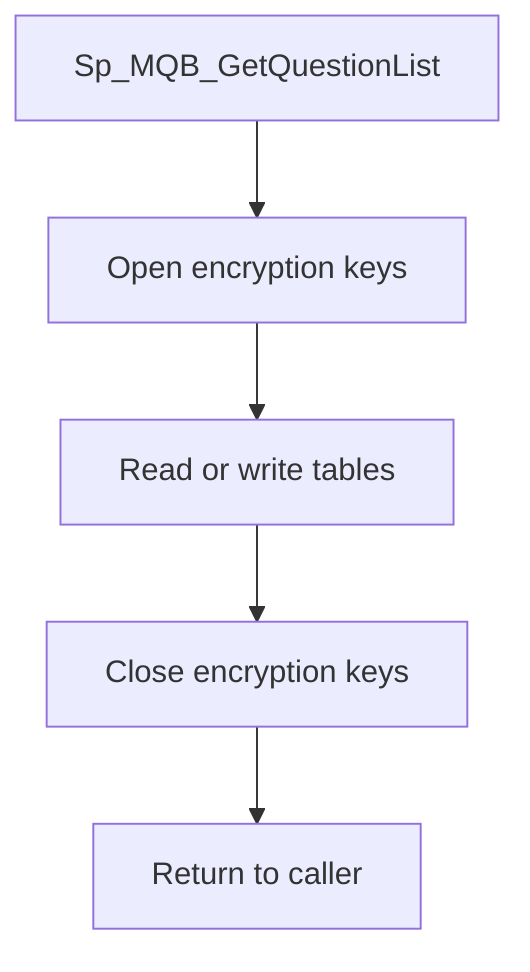

# Sp_MQB_GetQuestionList

## What it does

Returns the question grid for a root employer, optional filters, and module.

## Parameters

| Name | Direction | What it is for |
|---|---|---|
| `@pREId` | in | int |
| `@pQueCategoryId` | in | int (default NULL) |
| `@pQuestionaireTypeId` | in | int (default NULL) |
| `@pModuleId` | in | int (default null) |

## Call sequence

## Callers

No other procedure or function in the Master Question Bank direct set calls this object.

Application code may call it through `masterQuestionBankDAL`.

## Nested

| Object | Kind | When | Page |
|---|---|---|---|
| `Sp_OpenEncryptionKeys` | procedure | on the script path that reaches this call | [Sp_OpenEncryptionKeys](/docs/database/hrms/Sp_OpenEncryptionKeys) |
| `SP_CloseEncryptionKey` | procedure | on the script path that reaches this call | [SP_CloseEncryptionKey](/docs/database/hrms/SP_CloseEncryptionKey) |
| `Fn_GetEmployeeName` | function | on the script path that reaches this call | [Fn_GetEmployeeName](/docs/database/hrms/Fn_GetEmployeeName) |

## Steps

1. Calls `Sp_OpenEncryptionKeys` before reading encrypted name columns.
2. Calls `SP_CloseEncryptionKey` before returning.
3. Selects and returns one or more result sets for the caller.

## Tables

| Table | Read or write |
|---|---|
| `TQUESTION_LOOKUP` | read |
| `TLOOKUPT` | read |
| `TAssessment` | read |
| `TFeedback` | read |
| `TQuiz` | read |
| `TEmployeeTrainingEvaluationQuestion` | read |
| `TQuestion` | read |
| `TEvaluationTemplateQuestion` | read |
| `TQuestion_LOOKUP` | read |
| `Tcustomizelabel` | read |
| `TEmployeeTrainingEvaluation` | read |
| `TEvaluationTemplateSection` | read |
| `TTrainingEvaluationPhaseDetails` | read |
| `TTraining` | read |
| `TQuestion_Module` | read |
| `TEMPLOYEEINFO` | read |

## Flow

