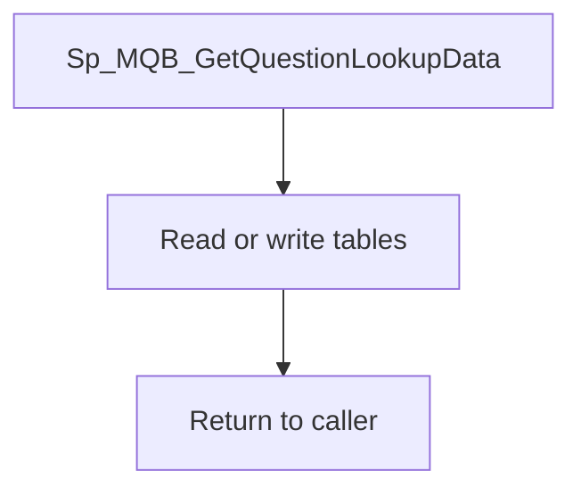

# Sp_MQB_GetQuestionLookupData

## What it does

Returns question lookup reference rows for a root employer and module.

## Parameters

| Name | Direction | What it is for |
|---|---|---|
| `@pRootEmployerID` | in | int |
| `@pModuleId` | in | int (default Null) |

## Call sequence

Calls no other procedures or functions.

## Callers

No other procedure or function in the Master Question Bank direct set calls this object.

Application code may call it through `masterQuestionBankDAL`.

## Nested

Calls no other procedures or functions.

## Steps

1. Selects and returns one or more result sets for the caller.

## Tables

| Table | Read or write |
|---|---|
| `Tcustomizelabel` | read |
| `TQuestion_LOOKUP` | read |
| `Temployerdetails` | read |
| `TQuestion_Lookup` | read |
| `TQuestion_Lookup_Module` | read |
| `THrmsModules` | read |

## Flow

