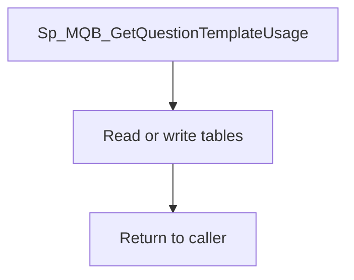

# Sp_MQB_GetQuestionTemplateUsage

## What it does

Reports active and inactive evaluation-template usage for a question.

## Parameters

| Name | Direction | What it is for |
|---|---|---|
| `@pQuestionId` | in | INT |

## Call sequence

Calls no other procedures or functions.

## Callers

No other procedure or function in the Master Question Bank direct set calls this object.

Application code may call it through `masterQuestionBankDAL`.

## Nested

Calls no other procedures or functions.

## Steps

1. Inserts into the target table(s) listed under Tables.

## Tables

| Table | Read or write |
|---|---|
| `TEvaluationTemplateQuestion` | read |
| `TEvaluationTemplateSection` | read |
| `TEvaluationTemplate` | read |

## Flow

