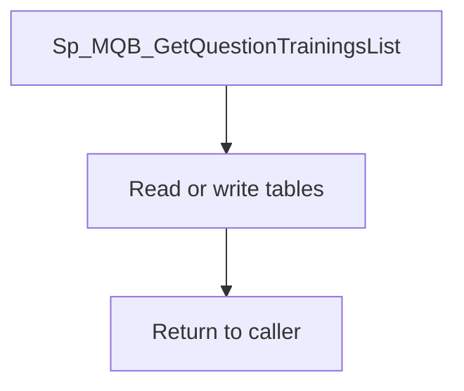

# Sp_MQB_GetQuestionTrainingsList

## What it does

Returns trainings mapped to a question text.

## Parameters

| Name | Direction | What it is for |
|---|---|---|
| `@pQuestionText` | in | NVARCHAR(max) |

## Call sequence

Calls no other procedures or functions.

## Callers

No other procedure or function in the Master Question Bank direct set calls this object.

Application code may call it through `masterQuestionBankDAL`.

## Nested

Calls no other procedures or functions.

## Steps

1. Selects and returns one or more result sets for the caller.

## Tables

| Table | Read or write |
|---|---|
| `TQuestion` | read |
| `TAssessment` | read |
| `TFeedback` | read |
| `TQuiz` | read |
| `TEmployeeTrainingEvaluationQuestion` | read |
| `TEmployeeTrainingEvaluation` | read |
| `TTraining` | read |

## Flow

