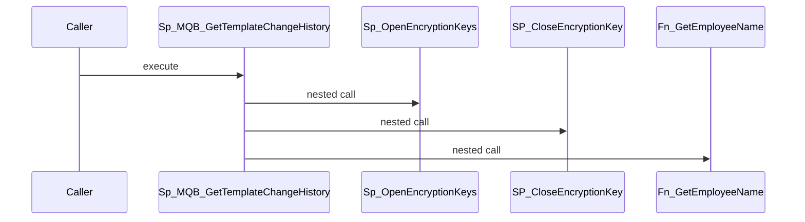
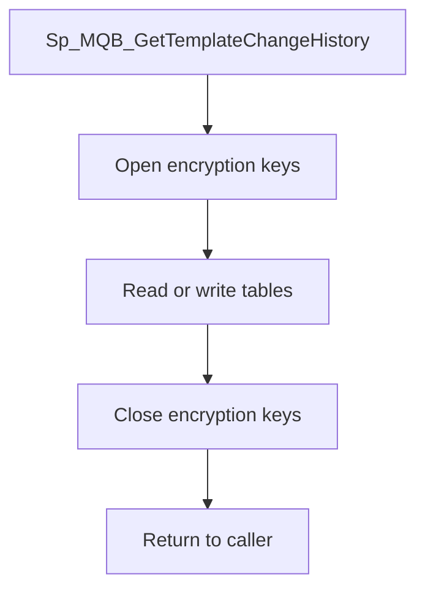

# Sp_MQB_GetTemplateChangeHistory

## What it does

Returns change-history rows for a template.

## Parameters

| Name | Direction | What it is for |
|---|---|---|
| `@pEvaluationTemplateId` | in | INT |

## Call sequence

## Callers

No other procedure or function in the Master Question Bank direct set calls this object.

Application code may call it through `masterQuestionBankDAL`.

## Nested

| Object | Kind | When | Page |
|---|---|---|---|
| `Sp_OpenEncryptionKeys` | procedure | on the script path that reaches this call | [Sp_OpenEncryptionKeys](/docs/database/hrms/Sp_OpenEncryptionKeys) |
| `SP_CloseEncryptionKey` | procedure | on the script path that reaches this call | [SP_CloseEncryptionKey](/docs/database/hrms/SP_CloseEncryptionKey) |
| `Fn_GetEmployeeName` | function | on the script path that reaches this call | [Fn_GetEmployeeName](/docs/database/hrms/Fn_GetEmployeeName) |

## Steps

1. Calls `Sp_OpenEncryptionKeys` before reading encrypted name columns.
2. Calls `SP_CloseEncryptionKey` before returning.
3. Selects and returns one or more result sets for the caller.

## Tables

| Table | Read or write |
|---|---|
| `TEvaluationTemplate_History` | read |
| `TEMPLOYEEINFO` | read |

## Flow

