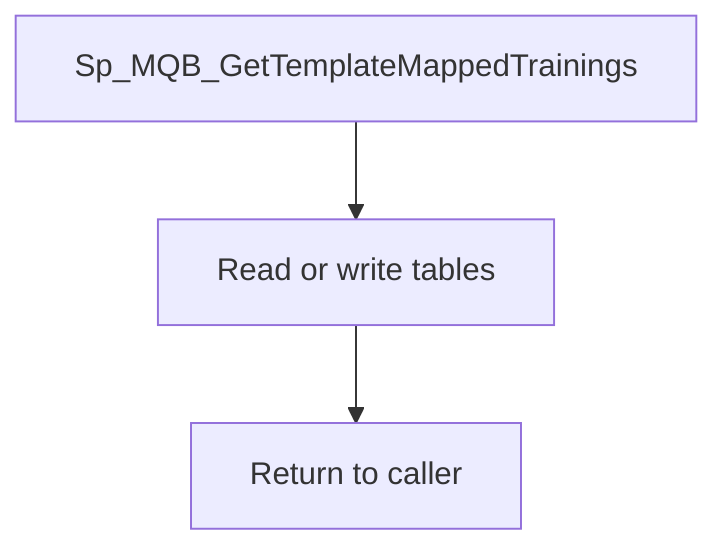

# Sp_MQB_GetTemplateMappedTrainings

## What it does

Returns trainings that use the evaluation template.

## Parameters

| Name | Direction | What it is for |
|---|---|---|
| `@pEvaluationTemplateId` | in | INT |

## Call sequence

Calls no other procedures or functions.

## Callers

No other procedure or function in the Master Question Bank direct set calls this object.

Application code may call it through `masterQuestionBankDAL`.

## Nested

Calls no other procedures or functions.

## Steps

1. Selects and returns one or more result sets for the caller.

## Tables

| Table | Read or write |
|---|---|
| `TQUESTION_LOOKUP` | read |
| `TEvaluationTemplateTraining` | read |
| `TTraining` | read |
| `TEvaluationTemplate` | read |

## Flow

