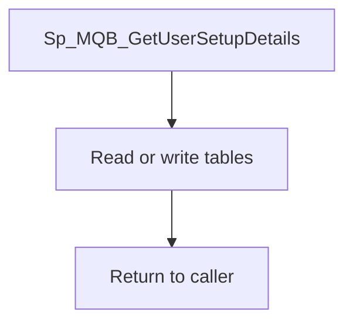

# Sp_MQB_GetUserSetupDetails

## What it does

Returns the multi-result user setup payload for the Master Question Bank React shell.

## Parameters

| Name | Direction | What it is for |
|---|---|---|
| `@pRoleId` | in | INT |
| `@pEmployerid` | in | INT |
| `@pEmployeeId` | in | INT |

## Call sequence

Calls no other procedures or functions.

## Callers

No other procedure or function in the Master Question Bank direct set calls this object.

Application code may call it through `masterQuestionBankDAL`.

## Nested

Calls no other procedures or functions.

## Steps

1. Selects and returns one or more result sets for the caller.

## Tables

| Table | Read or write |
|---|---|
| `temployerdetails` | read |
| `TCLAIM_ASSIGNMENT` | read |
| `TLOOKUPT` | read |
| `TEmployeeInfo` | read |
| `TORGChart` | read |
| `TTrainingSurvey` | read |
| `TCustomerSettings` | read |
| `TWorkflowDetails` | read |
| `TCLAIM` | read |
| `TOrgHierarchyDetails` | read |
| `TEmployerDetails` | read |
| `TWorkflowManagement` | read |

## Flow

