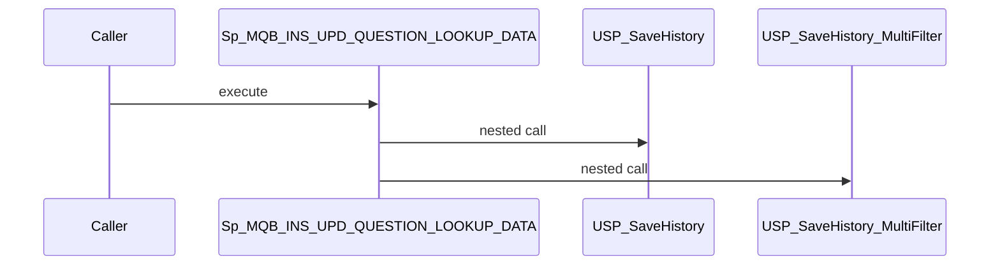
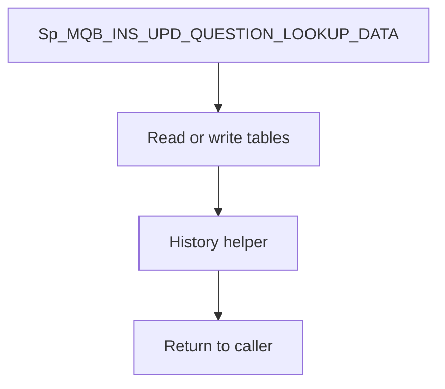

# Sp_MQB_INS_UPD_QUESTION_LOOKUP_DATA

## What it does

Inserts or updates a question lookup row for a module and writes history.

## Parameters

| Name | Direction | What it is for |
|---|---|---|
| `@LookupID` | in | INT |
| `@LookupText` | in | NVARCHAR(100) |
| `@LookupParentId` | in | INT |
| `@SubParentId` | in | INT |
| `@pEmployerid` | in | INT |
| `@pModuleId` | in | INT |
| `@pCreatedBy` | in | INT |

## Call sequence

## Callers

No other procedure or function in the Master Question Bank direct set calls this object.

Application code may call it through `masterQuestionBankDAL`.

## Nested

| Object | Kind | When | Page |
|---|---|---|---|
| `USP_SaveHistory` | procedure | on the script path that reaches this call | No page yet |
| `USP_SaveHistory_MultiFilter` | procedure | on the multi-filter history path | [USP_SaveHistory_MultiFilter](/docs/database/hrms/USP_SaveHistory_MultiFilter) |

## Steps

1. Inserts into the target table(s) listed under Tables.
2. Updates matching rows when the script path is an update or soft-delete.
3. Calls history helper(s) after the primary write.

## Tables

| Table | Read or write |
|---|---|
| `TQuestion_Lookup` | read and write |
| `TQuestion_Lookup_Module` | write |
| `sys` | read |

## Flow

