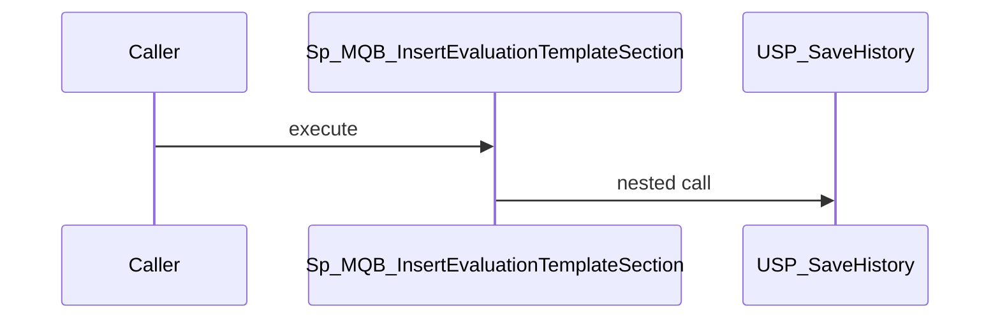
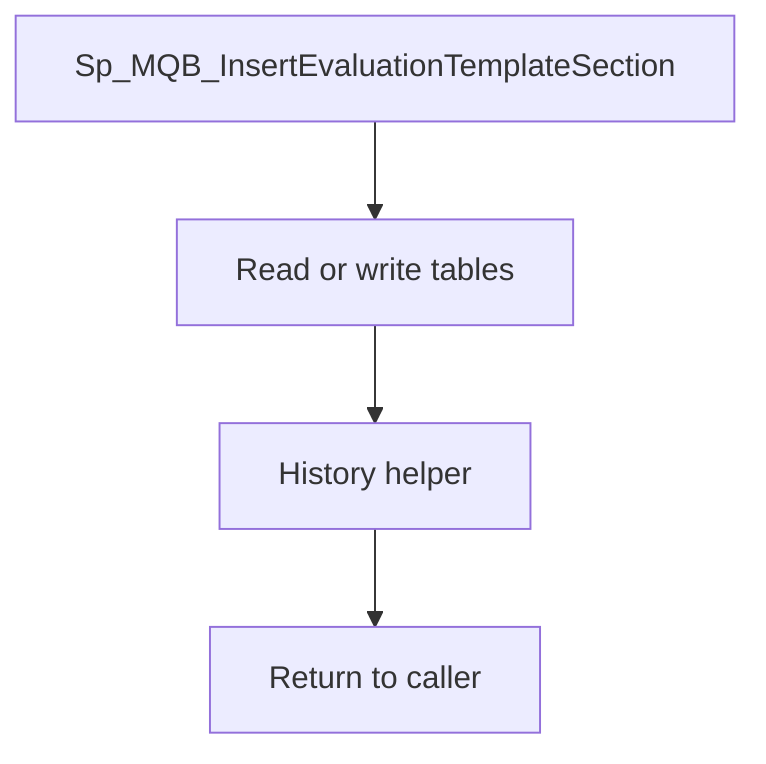

# Sp_MQB_InsertEvaluationTemplateSection

## What it does

Inserts a template section and writes history.

## Parameters

| Name | Direction | What it is for |
|---|---|---|
| `@pEvaluationTemplateId` | in | INT |
| `@pSectionName` | in | NVARCHAR(200) |
| `@pDisplayOrder` | in | INT |
| `@pMandatoryMode` | in | VARCHAR(10) (default 'all') |
| `@pRemarksMode` | in | VARCHAR(10) (default 'none') |
| `@pRemarksLabel` | in | NVARCHAR(100) (default 'Remarks') |
| `@pIsRemarksMandatory` | in | BIT (default 0) |
| `@pCreatedBy` | in | INT |
| `@pEvaluationTemplateSectionId` | in | INT (default 0 OUTPUT) |

## Call sequence

## Callers

No other procedure or function in the Master Question Bank direct set calls this object.

Application code may call it through `masterQuestionBankDAL`.

## Nested

| Object | Kind | When | Page |
|---|---|---|---|
| `USP_SaveHistory` | procedure | on the script path that reaches this call | No page yet |

## Steps

1. Inserts into the target table(s) listed under Tables.
2. Calls history helper(s) after the primary write.

## Tables

| Table | Read or write |
|---|---|
| `TEvaluationTemplateSection` | read and write |
| `sys` | read |

## Flow

