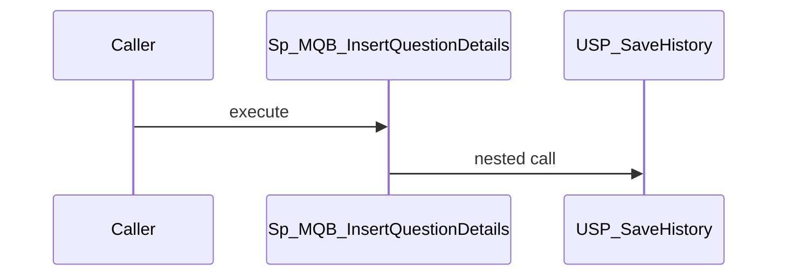
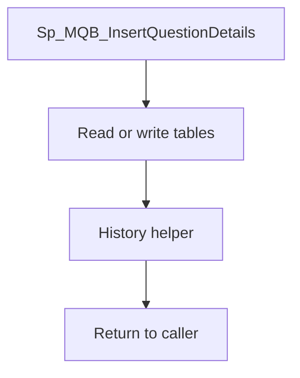

# Sp_MQB_InsertQuestionDetails

## What it does

Inserts a TQuestion row and module mapping, then writes history.

## Parameters

| Name | Direction | What it is for |
|---|---|---|
| `@pEmployerId` | in | int |
| `@pQuestionText` | in | nvarchar(1000) |
| `@pQuesTypeCD` | in | int (default null) |
| `@pQuestionCategoryCD` | in | int |
| `@pAnswerTypeCD` | in | int |
| `@pQuestionComplexityCD` | in | int (default null) |
| `@pTraingTypeId` | in | int (default null) |
| `@pQuestionaireTypeId` | in | int (default null) |
| `@pCreatedBy` | in | int |
| `@pQuestionID` | out | int (default 0) |
| `@pIsTrainerScore` | in | Bit (default null) |
| `@pModuleId` | in | int |
| `@pRatingLevel` | in | int (default null) |

## Call sequence

## Callers

No other procedure or function in the Master Question Bank direct set calls this object.

Application code may call it through `masterQuestionBankDAL`.

## Nested

| Object | Kind | When | Page |
|---|---|---|---|
| `USP_SaveHistory` | procedure | on the script path that reaches this call | No page yet |

## Steps

1. Opens a try block and begins a transaction when the script mutates data.
2. Inserts into the target table(s) listed under Tables.
3. Calls history helper(s) after the primary write.

## Tables

| Table | Read or write |
|---|---|
| `TQuestion` | write |
| `TQuestion_Module` | write |
| `sys` | read |
| `TEmployerDetails` | read |
| `TCustomerSettings` | read |
| `TEmployeeInfo` | read |

## Flow

