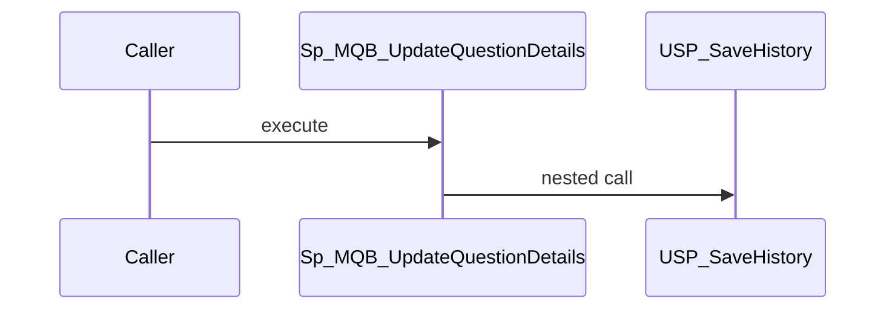
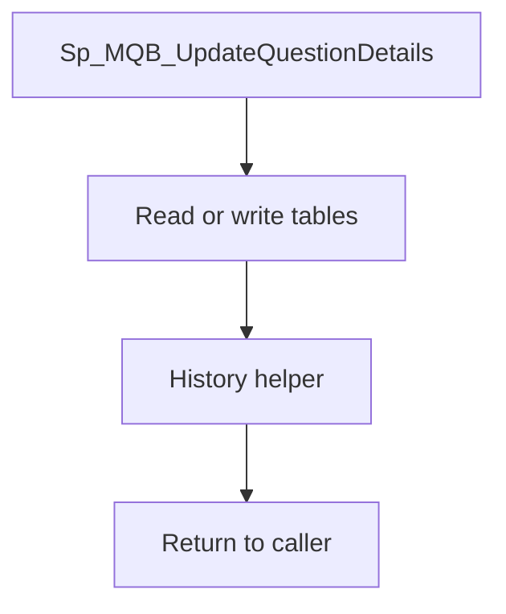

# Sp_MQB_UpdateQuestionDetails

## What it does

Updates an existing TQuestion row and writes history.

## Parameters

| Name | Direction | What it is for |
|---|---|---|
| `@pQuestionText` | in | Nvarchar(1000) |
| `@pQuestionCategoryCD` | in | int |
| `@pAnswerTypeCD` | in | int |
| `@pQuestionComplexityCD` | in | int |
| `@pCreatedBy` | in | int |
| `@pQuestionID` | in | int |
| `@pRatingLevel` | in | int (default null) |

## Call sequence

## Callers

No other procedure or function in the Master Question Bank direct set calls this object.

Application code may call it through `masterQuestionBankDAL`.

## Nested

| Object | Kind | When | Page |
|---|---|---|---|
| `USP_SaveHistory` | procedure | on the script path that reaches this call | No page yet |

## Steps

1. Updates matching rows when the script path is an update or soft-delete.
2. Calls history helper(s) after the primary write.

## Tables

| Table | Read or write |
|---|---|
| `TQuestion` | write |
| `sys` | read |

## Flow

