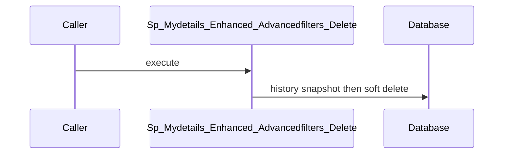
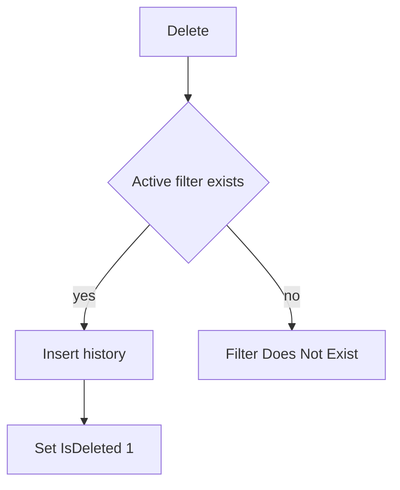

# Sp_Mydetails_Enhanced_Advancedfilters_Delete

## What it does

Soft-deletes a saved advanced filter (`IsDeleted = 1`) after copying the current row into history. Returns success/failure messaging for the API layer.

## Parameters

| Name | Direction | What it is for |
|---|---|---|
| `@FilterID` | in | Filter to remove |
| `@DeletedBy` | in | Employee recorded as updater |

## Call sequence

## Callers

Application caller: `teamMemberSavedFilters.deleteTeamMemberSavedFilter`.

## Nested

None.

## Steps

1. Script is `HRMS-DATABASE/HRMS/STOREPROCEDURE/Sp_Mydetails_Enhanced_Advancedfilters_Delete.sql`.
2. If the filter exists and is active, insert history then set `IsDeleted = 1`.
3. Otherwise return Filter Does Not Exist.

## Tables

| Table | Read or write |
|---|---|
| `dbo.Mydetails_Enhanced_Advancedfilters` | read and write |
| `dbo.Mydetails_Enhanced_Advancedfilters_History` | write |

## Flow

