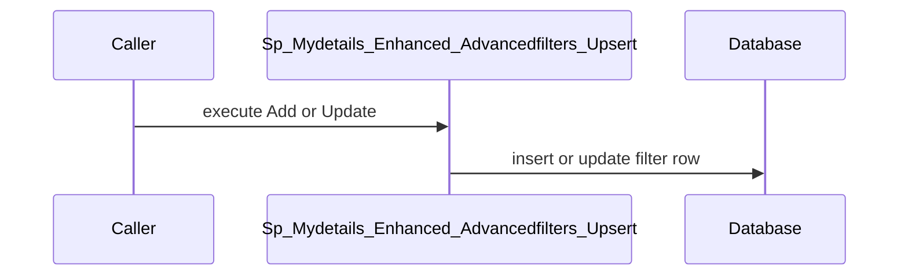
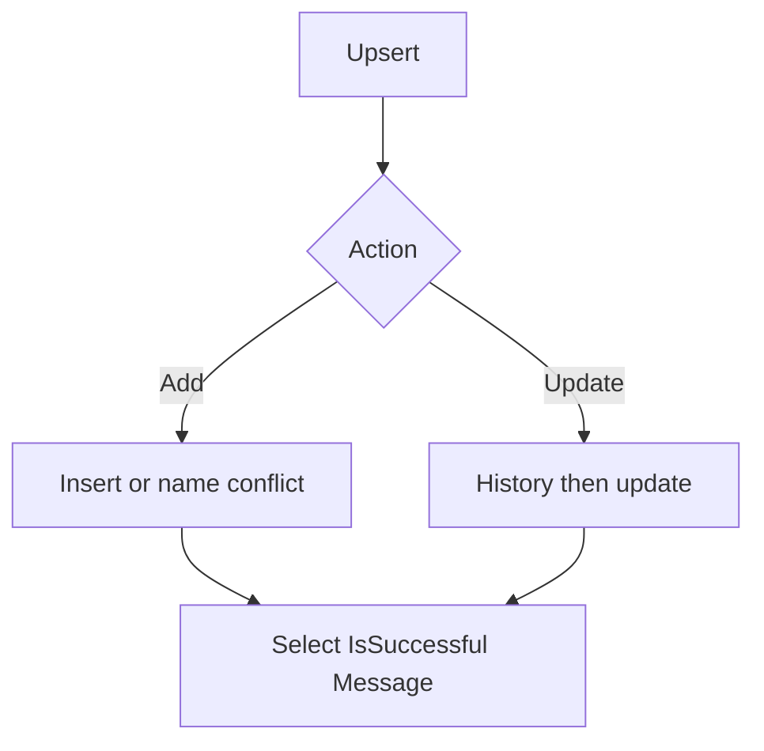

# Sp_Mydetails_Enhanced_Advancedfilters_Upsert

## What it does

Adds or updates a saved team-member / Search Employee advanced filter. Enforces unique filter names per employer among active rows, writes history on update, and returns `IsSuccessful` / `Message`.

## Parameters

| Name | Direction | What it is for |
|---|---|---|
| `@FilterID` | in | Existing filter id for Update; null for Add |
| `@FilterName` | in | Display name |
| `@FilterData` | in | JSON conditions payload |
| `@IsPublic` | in | Shared with employer when true |
| `@IsDeleted` | in | Soft-delete flag on insert path |
| `@EmployerId` | in | Employer scope |
| `@Action` | in | `Add` or `Update` |
| `@CreatedBy` | in | Acting employee id |

## Call sequence

## Callers

Application caller: `teamMemberSavedFilters.createTeamMemberSavedFilter` / `updateTeamMemberSavedFilter`.

## Nested

None.

## Steps

1. Script is `HRMS-DATABASE/HRMS/STOREPROCEDURE/Sp_Mydetails_Enhanced_Advancedfilters_Upsert.sql`.
2. On `Add`, insert when the name is free; otherwise return Filter Already Exists.
3. On `Update`, archive the current row to history then update when the id exists and the new name does not collide.
4. Return success/failure message rows.

## Tables

| Table | Read or write |
|---|---|
| `dbo.Mydetails_Enhanced_Advancedfilters` | read and write |
| `dbo.Mydetails_Enhanced_Advancedfilters_History` | write |

## Flow

