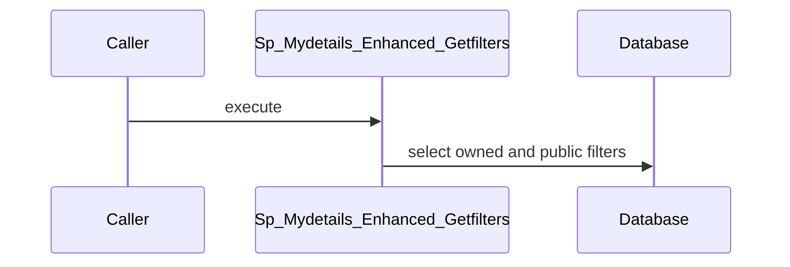
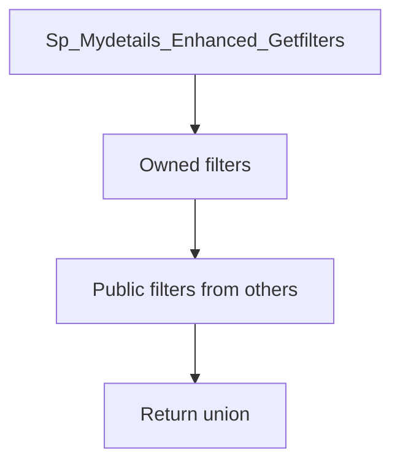

# Sp_Mydetails_Enhanced_Getfilters

## What it does

Returns saved advanced filters for one employer that the employee may see: filters they created, plus other users’ public filters that are not deleted.

## Parameters

| Name | Direction | What it is for |
|---|---|---|
| `@EmployerId` | in | Employer scope |
| `@EmployeeId` | in | Logged-in employee (owner or public viewer) |

## Call sequence

## Callers

Application caller: New Look Search Employee via `teamMemberSavedFilters.getTeamMemberSavedFilters` → TeamMembers saved-filters API.

## Nested

None.

## Steps

1. Script is `HRMS-DATABASE/HRMS/STOREPROCEDURE/Sp_Mydetails_Enhanced_Getfilters.sql`.
2. Select non-deleted filters created by `@EmployeeId` for `@EmployerId`.
3. Union non-deleted public filters created by others for the same employer.

## Tables

| Table | Read or write |
|---|---|
| `dbo.Mydetails_Enhanced_Advancedfilters` | read |

## Flow

