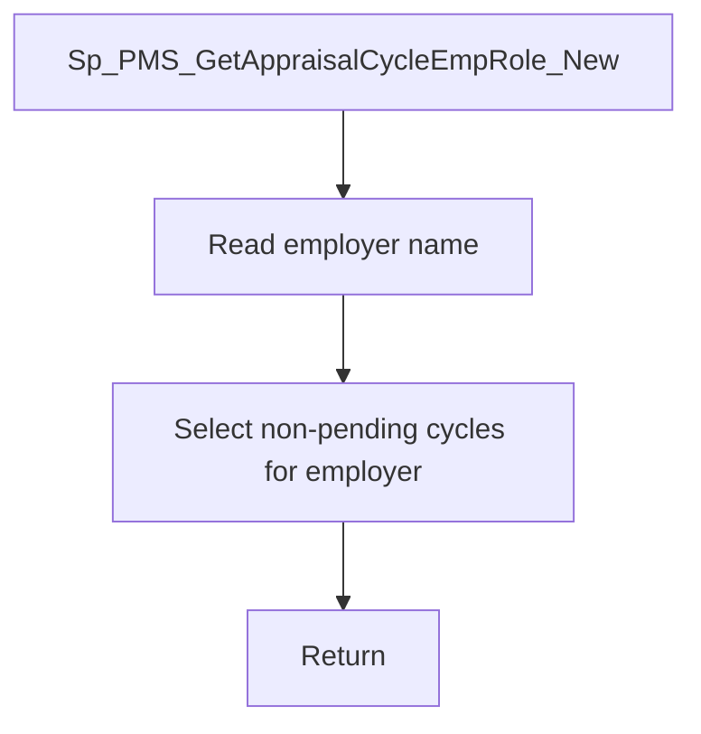

# Sp_PMS_GetAppraisalCycleEmpRole_New

## What it does

Lists non-deleted appraisal cycles for an employer whose `CycleStatus` is not `Pending`, ordered newest first. Display `CycleName` concatenates the cycle name, status, and employer name from `TPMSEmployerConfiguration`. Despite the name, the procedure does **not** filter by employee role — `@EmployeeId` is unused.

## Parameters

| Name | Direction | What it is for |
|---|---|---|
| `@EmployeeId` | in | Unused by the current script body |
| `@EmployerId` | in | Employer whose cycles are returned |

## Call sequence

Calls no other procedures or functions.

## Callers

No other procedure or function calls this object. `performanceAssessmentDAL.GetPrevAppraisalCycleListByEmployeeRole` executes it for Normalization (and other PMS cycle pickers).

## Nested

Calls no other procedures or functions.

## Steps

1. Script is `HRMS-DATABASE/HRMS/STOREPROCEDURE/Sp_PMS_GetAppraisalCycleEmpRole_New.sql`.
2. Read employer name from `TPMSEmployerConfiguration` into `@Lv_EmployerName` (used only in the `ORDER BY` expression).
3. Select `AppraisalCycleId`, display `CycleName`, `ProcessType`, and raw `AppraisalCycleName` from `TPMSAppraisalCycles` where `EmployerID = @EmployerId`, `IsDeleted = 0`, and `CycleStatus <> 'Pending'`.

## Tables

| Table | Read or write |
|---|---|
| `TPMSEmployerConfiguration` | read |
| `TPMSAppraisalCycles` | read |

## Unresolved calls

None.

## Flow

