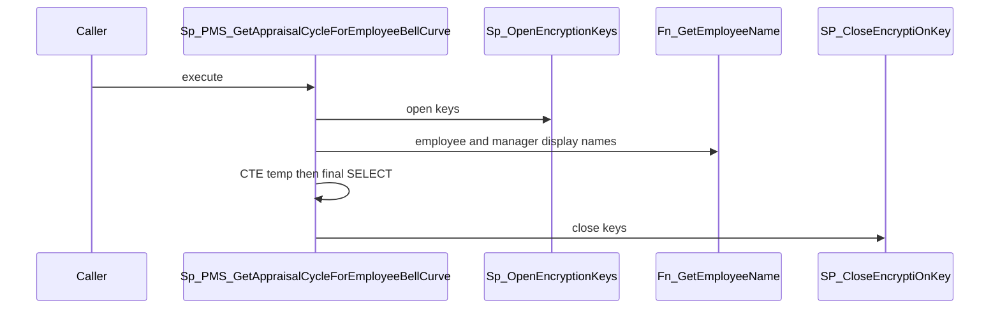
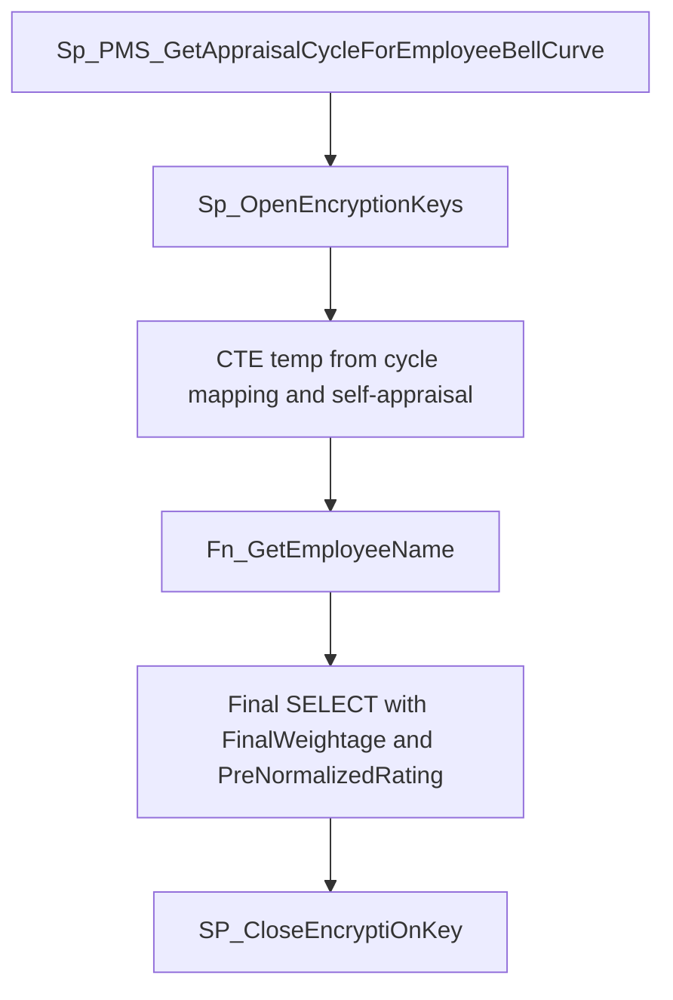

# Sp_PMS_GetAppraisalCycleForEmployeeBellCurve

## What it does

Builds the Normalization employee grid for one employer, appraisal cycle, and review frequency. Joins cycle mapping, self-appraisal, and review frequency; pulls L1–L4 cumulative ratings, final weightage (latest or average per employer config), existing Normalization/Comments, previous Normalization, colour codes from the rating/weightage/outcome scale, routing levels from workflow, and `IsOutcomeType` from `OutcomeId`. Opens encryption keys so `Fn_GetEmployeeName` can decrypt names. An older branch that read only from `TPMSEmployeeAppraisalForBellCurve` is commented out — the live path always rebuilds from self-appraisal.

## Parameters

| Name | Direction | What it is for |
|---|---|---|
| `@EmployerID` | in | Employer of `TEmployeeInfo` |
| `@AppraisalCycleId` | in | Cycle to list |
| `@ReviewFrequncyId` | in | Review frequency (default 0; must match for rows) |
| `@EmployeeID` | in | Intended location-BU scope; **unused** on the live path (`FN_LocationBU_GetEmployeeDetails` join is commented out) |

## Call sequence

## Callers

No other procedure or function calls this object. `performanceAssessmentDAL.GetAppraisalEmployeeListForBellCurve` executes it for Normalization Search / auto-load.

## Nested

| Object | Kind | When | Page |
|---|---|---|---|
| `Sp_OpenEncryptionKeys` | procedure | start | [Sp_OpenEncryptionKeys](/docs/database/hrms/Sp_OpenEncryptionKeys) |
| `Fn_GetEmployeeName` | function | employee and L1/L2 names | [Fn_GetEmployeeName](/docs/database/hrms/Fn_GetEmployeeName) |
| `SP_CloseEncryptiOnKey` | procedure | end (script spelling) | [SP_CloseEncryptiOnKey](/docs/database/hrms/SP_CloseEncryptiOnKey) |

`FN_LocationBU_GetEmployeeDetails` appears only in commented SQL and is not executed.

## Steps

1. Script is `HRMS-DATABASE/HRMS/STOREPROCEDURE/Sp_PMS_GetAppraisalCycleForEmployeeBellCurve.sql`.
2. `EXEC Sp_OpenEncryptionKeys`.
3. CTE `temp` joins `TPMSAppraisalCycles`, `TPMS_AppraisalReviewFrequency` (active `FormActivedate`), mapping, self-appraisal, and `TEmployeeInfo` for `@EmployerID` / cycle / frequency.
4. Subqueries fill designation, BU, org name, L1/L2 managers, L1–L4 cumulative ratings, Normalization/Comments from `TPMSEmployeeAppraisalForBellCurve`, min/max from the cycle score method, colour, routing levels, and final-rating mode.
5. Outer SELECT dedupes colour, formats rounded ratings, computes `FinalWeightage` / `FinalWeightageAvg`, and looks up `PreNormalizedRating` from a prior cycle/frequency.
6. `EXEC SP_CloseEncryptiOnKey`.

## Tables

| Table | Read or write |
|---|---|
| `TPMSAppraisalCycles` | read |
| `TPMS_AppraisalReviewFrequency` | read |
| `TPMSEmployeeAppraisalCycleMapping` | read |
| `TPMSEmployeeSelfAppraisal` | read |
| `TEmployeeInfo` | read |
| `TPMSEmployeeAppraisalForBellCurve` | read |
| `TPMSAppraisalCumulativeRating` | read |
| `TPMSEmployerConfiguration` | read |
| `TPMSRatingScaleDetails` | read |
| `TPMSWeightageScaleDetails` | read |
| `TPMSGoalCategoryOutcomeDeatils` | read |
| `TTitle` | read |
| `TOrgHierarchyDetails` | read |
| `TORGChart` | read |
| `TWorkflowManagement` | read |
| `TRequestWorkflows` | read |

## Unresolved calls

None on the live path.

## Flow

