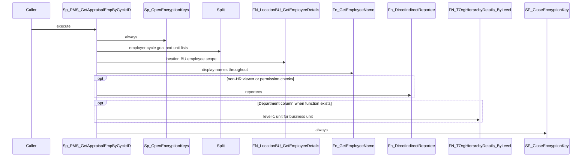
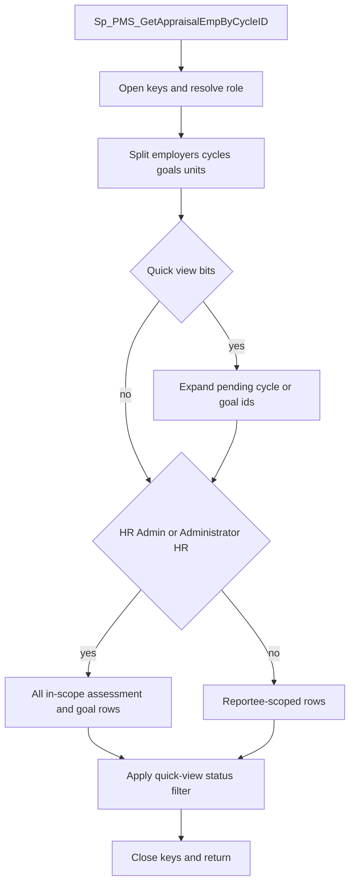

# Sp_PMS_GetAppraisalEmpByCycleID

## What it does

Returns the Assessment Report / Assessment Status style employee list for one or more appraisal cycles (and optionally goal periods). Each row includes cycle label, employee identity, managers, organisation, business unit, employment type, form status, pending-with text, final score, rating definition, and related HR/view flags. HR/Admin/`Administrator`/`HR` roles see all mapped employees in scope; other roles are limited to functional/reporting managers and `Fn_DirectIndirectReportee` trees. Assessment Report always calls with a single cycle id, empty organisation units, `goalSettingId = '0'`, and both quick-view bits off.

## Parameters

| Name | Direction | What it is for |
|---|---|---|
| `@EmployerIds` | in | Comma-separated employer ids |
| `@AppraisalCycleId` | in | Comma-separated cycle ids (default `'0'`) |
| `@OrganizationUnits` | in | Optional comma-separated BU ids; empty becomes null |
| `@EmployeeId` | in | Viewer employee for role and reportee filters |
| `@GoalSettingId` | in | Comma-separated goal period ids (default `'0'`) |
| `@QuickViewForAssessment` | in | When 1, expands pending/submitted assessment cycles |
| `@QuickViewForGoalSettings` | in | When 1, expands pending/submitted goal periods |

## Call sequence

## Callers

No other procedure or function calls this object.

## Nested

| Object | Kind | When | Page |
|---|---|---|---|
| `Sp_OpenEncryptionKeys` | procedure | always at start | [Sp_OpenEncryptionKeys](/docs/database/hrms/Sp_OpenEncryptionKeys) |
| `Split` | function | split employer/cycle/goal/unit lists | [Split](/docs/database/hrms/Split) |
| `FN_LocationBU_GetEmployeeDetails` | function | restrict employees by location/BU access | [FN_LocationBU_GetEmployeeDetails](/docs/database/hrms/FN_LocationBU_GetEmployeeDetails) |
| `Fn_GetEmployeeName` | function | employee and manager display names | [Fn_GetEmployeeName](/docs/database/hrms/Fn_GetEmployeeName) |
| `Fn_DirectIndirectReportee` | function | manager/non-HR visibility | [Fn_DirectIndirectReportee](/docs/database/hrms/Fn_DirectIndirectReportee) |
| `FN_TOrgHierarchyDetails_ByLevel` | function | when present, Department from hierarchy level 1 | [FN_TOrgHierarchyDetails_ByLevel](/docs/database/hrms/FN_TOrgHierarchyDetails_ByLevel) |
| `SP_CloseEncryptionKey` | procedure | always at end | [SP_CloseEncryptionKey](/docs/database/hrms/SP_CloseEncryptionKey) |

## Steps

1. Open encryption keys and resolve the viewer’s `RoleID` / `RoleType` from `TUsers` / `TRoles` / `TUserEmployee` / `TEmployee`.

2. Split `@EmployerIds`, `@OrganizationUnits` (null if empty), `@AppraisalCycleId`, and `@GoalSettingId` into table variables.

3. If `@QuickViewForAssessment = 1`, replace `@AppraisalCycleId` with up to 100 recent cycles that still have Pending/Submitted forms. If `@QuickViewForGoalSettings = 1`, similarly expand goal period ids.

4. **HR/Admin path** (`RoleID` 1/2/9 or role type Administrator/HR): union self-appraisal rows for the selected cycles with initiated goal-mapping rows for selected goal ids (Assessment Report usually only hits the assessment half). Compute FormStatus, RequestPendingWith, FinalScore, RatingDefination, cumulative ratings, and related columns from workflows, scales, bell-curve, and employer configuration.

5. **Manager path**: same shape, but filter employees to functional/reporting manager of the viewer or `Fn_DirectIndirectReportee`.

6. Apply quick-view status filters when those bits are set; otherwise return all statuses. Order by assessment id, review frequency, employee.

7. Close encryption keys.

## Tables

| Table | Read or write |
|---|---|
| `TUsers` | read |
| `TRoles` | read |
| `TUserEmployee` | read |
| `TEmployee` | read |
| `TEmployeeInfo` | read |
| `TPMSAppraisalCycles` | read |
| `TPMSEmployeeSelfAppraisal` | read |
| `TPMS_AppraisalReviewFrequency` | read |
| `TPMSEmployeeAppraisalCycleMapping` | read |
| `TPMSCategoryMaster` | read |
| `TPMSAppraisalPermissions` | read |
| `TPMSEmployerConfiguration` | read |
| `TRequestWorkflows` | read |
| `TOrgHierarchyDetails` | read |
| `TTitle` | read |
| `TMEmploymentTypes` | read |
| `TPMSEmpAppraisalHRComments` | read |
| `TPMSAppraisalCumulativeRating` | read |
| `TPMSRatingScaleDetails` | read |
| `TPMSWeightageScaleDetails` | read |
| `TPMSEmployeeAppraisalForBellCurve` | read |
| `TPMSAssessmentViewManagerPermissions` | read |
| `TORGChart` | read |
| `TWorkflowDetails` | read |
| `TQualificationName` | read |
| `TEducationDetails` | read |
| `TPMSEmployeeGoalSetting` | read |
| `TPMSEmployeeGoalMapping` | read |
| `TPMS_GoalSettingReviewFrequency` | read |
| `TPMSEmployeeGoalSettingReviewLevel` | read |
| `TPMSEmployeeGoalFormData` | read |

## Flow

