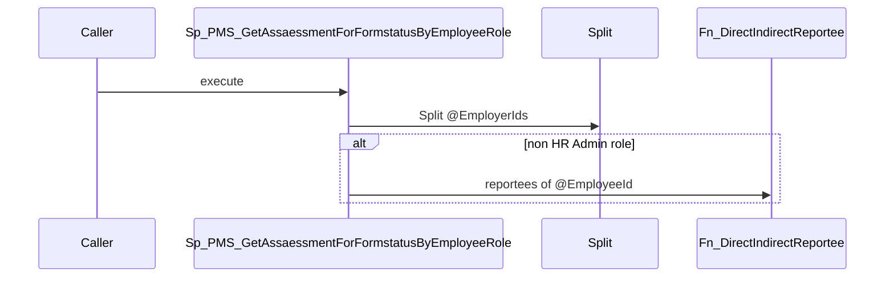
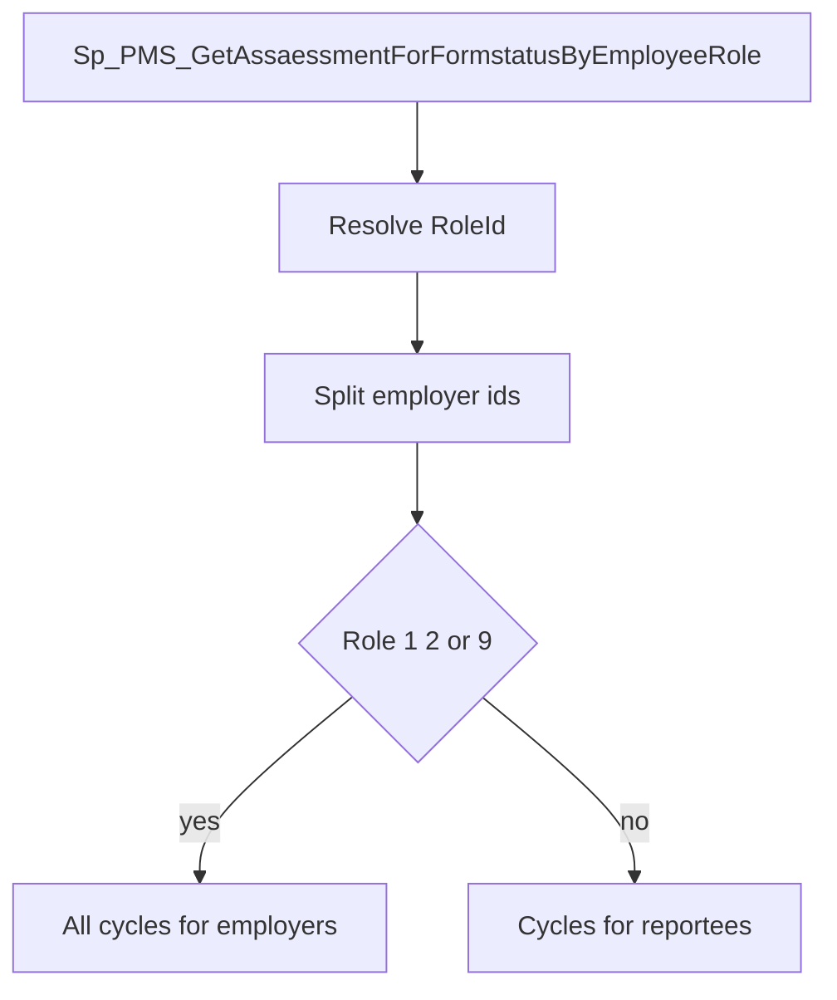

# Sp_PMS_GetAssaessmentForFormstatusByEmployeeRole

## What it does

Returns appraisal cycles the logged-in employee may filter on Assessment Status. HR/Admin roles (RoleId 1, 2, or 9) see all non-deleted cycles for the employers. Other roles see cycles that are not Pending and that include self-appraisal forms for their direct/indirect reportees (competency or goal paths).

## Parameters

| Name | Direction | What it is for |
|---|---|---|
| `@EmployeeId` | in | Logged-in employee |
| `@EmployerIds` | in | Comma-separated employer ids |

## Call sequence

## Callers

No other procedure or function calls this object.

## Nested

| Object | Kind | When | Page |
|---|---|---|---|
| `Split` | function | split employer ids | [Split](/docs/database/hrms/Split) |
| `Fn_DirectIndirectReportee` | function | non–HR/Admin branch | [Fn_DirectIndirectReportee](/docs/database/hrms/Fn_DirectIndirectReportee) |

## Steps

Script: `HRMS-DATABASE/HRMS/STOREPROCEDURE/Sp_PMS_GetAssaessmentForFormstatusByEmployeeRole.sql`.

1. Resolve `@RoleID` from `TUsers` / `TRoles` / `TUserEmployee` / `TEmployee` for the active employee.
2. Split `@EmployerIds`.
3. If RoleId is 1, 2, or 9, select all non-deleted cycles for those employers with employer name suffix.
4. Else union cycles with competency ratings or employee goals for reportees from `Fn_DirectIndirectReportee(@EmployeeId,-2)`, excluding Pending cycle status.

## Tables

| Table | Read or write |
|---|---|
| `TUsers` | read |
| `TRoles` | read |
| `TUserEmployee` | read |
| `TEmployee` | read |
| `TPMSAppraisalCycles` | read |
| `TPMSEmployerConfiguration` | read |
| `TPMSEmployeeSelfAppraisal` | read |
| `TPMSEmployeeCompetencyRatings` | read |
| `TPMSEmployeeGoals` | read |

## Flow

