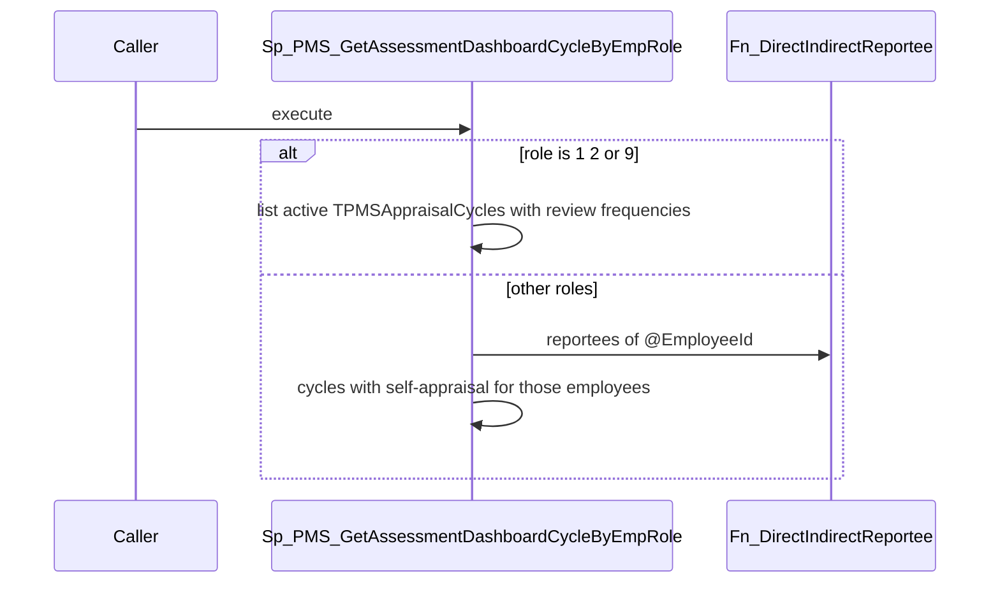
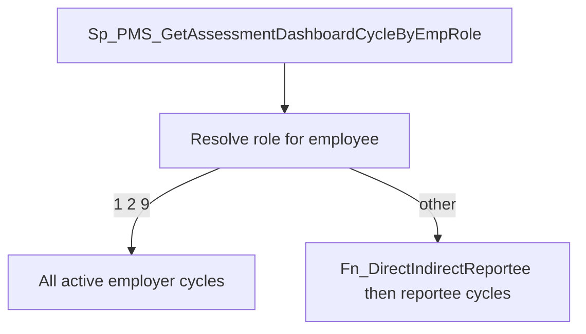

# Sp_PMS_GetAssessmentDashboardCycleByEmpRole

## What it does

Returns active appraisal cycle / review-frequency options for the PMS Dashboard. HR and Admin roles (role ids 1, 2, 9) see every active cycle for the employer whose form active date has passed. Other roles see only cycles that include a self-appraisal for a direct or indirect reportee of `@EmployeeId`.

## Parameters

| Name | Direction | What it is for |
|---|---|---|
| `@EmployeeId` | in | Signed-in employee used for role and reportee scope |
| `@EmployerId` | in | Employer whose cycles are listed |

## Call sequence

## Callers

No other procedure or function calls this object. App caller: `performanceAssessmentDAL.GetAssessmentCycles` from PMS Dashboard.

## Nested

| Object | Kind | When | Page |
|---|---|---|---|
| `Fn_DirectIndirectReportee` | function | non-admin / non-HR role branch | [Fn_DirectIndirectReportee](/docs/database/hrms/Fn_DirectIndirectReportee) |

## Steps

In `HRMS-DATABASE/HRMS/STOREPROCEDURE/Sp_PMS_GetAssessmentDashboardCycleByEmpRole.sql`:

1. Read `Employername` from `TPMSEmployerConfiguration` for `@EmployerId` into a local.
2. Resolve `@RoleID` from `TUsers` / `TRoles` / `TUserEmployee` / `TEmployee` for the active `@EmployeeId`.
3. When role is 1, 2, or 9, select distinct cycle id, cycle name plus review frequency label, and `ReviewFrequencyId` from active `tpmsappraisalcycles` joined to `TPMS_AppraisalReviewFrequency` where frequency status is not Pending and `FormActivedate <= getdate()`.
4. Otherwise select the same columns for cycles that have a `tpmsemployeeselfappraisal` row for an employee in `Fn_DirectIndirectReportee(@EmployeeId, -2)`.
5. Order by cycle id descending, review frequency ascending.

## Tables

| Table | Read or write |
|---|---|
| `dbo.TPMSEmployerConfiguration` | read |
| `dbo.TUsers` | read |
| `dbo.TRoles` | read |
| `dbo.TUserEmployee` | read |
| `dbo.TEmployee` | read |
| `dbo.TPMSAppraisalCycles` | read |
| `dbo.TPMS_AppraisalReviewFrequency` | read |
| `dbo.TPMSEmployeeSelfAppraisal` | read |

## Flow

