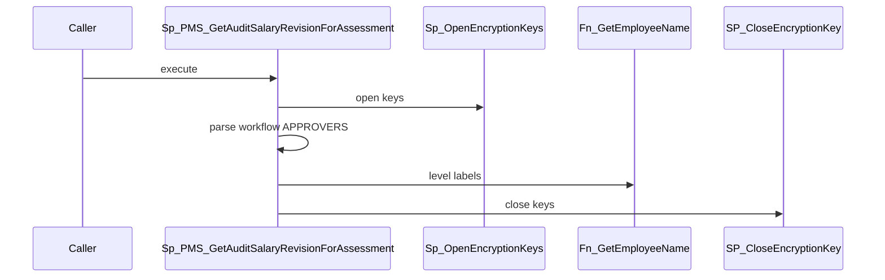
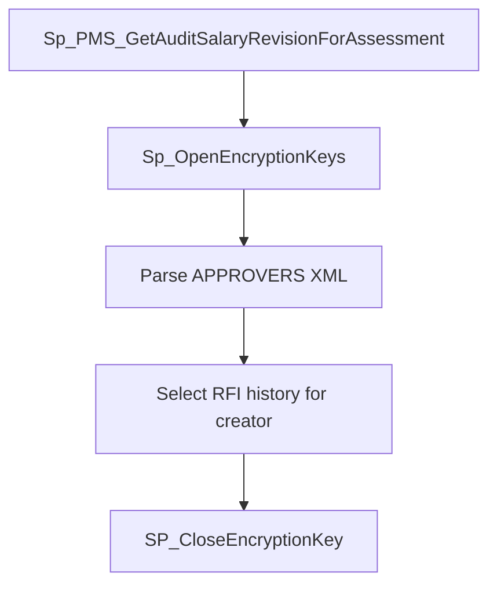

# Sp_PMS_GetAuditSalaryRevisionForAssessment

## What it does

Returns the RFI history grid for Salary Recommendations for questions/answers the logged-in employee created on a cycle. Same workflow APPROVERS XML role mapping as the revoke list, but without the unprocessed-only filter so History can show the full thread including evidence file names.

## Parameters

| Name | Direction | What it is for |
|---|---|---|
| `@AppraisalCycleId` | in | Cycle id |
| `@LoggedInEmployeeId` | in | Creator filter (`CreatedBy`) |

## Call sequence

## Callers

No other procedure or function calls this object. `performanceAssessmentDAL.GetAuditSalaryRevisionForAssessment` executes it for View History.

## Nested

| Object | Kind | When | Page |
|---|---|---|---|
| `Sp_OpenEncryptionKeys` | procedure | start | [Sp_OpenEncryptionKeys](/docs/database/hrms/Sp_OpenEncryptionKeys) |
| `Fn_GetEmployeeName` | function | level labels | [Fn_GetEmployeeName](/docs/database/hrms/Fn_GetEmployeeName) |
| `SP_CloseEncryptionKey` | procedure | end | [SP_CloseEncryptionKey](/docs/database/hrms/SP_CloseEncryptionKey) |

## Steps

1. Script is `HRMS-DATABASE/HRMS/STOREPROCEDURE/Sp_PMS_GetAuditSalaryRevisionForAssessment.sql`.
2. Resolve employer/workflow; parse APPROVERS roles.
3. SELECT RFI rows created by `@LoggedInEmployeeId` for the cycle.
4. Close encryption keys.

## Tables

| Table | Read or write |
|---|---|
| `TPMSAppraisalCycles` | read |
| `TWorkflowManagement` | read |
| `TPMSSalaryRevisionForMoreInfo` | read |

## Flow

